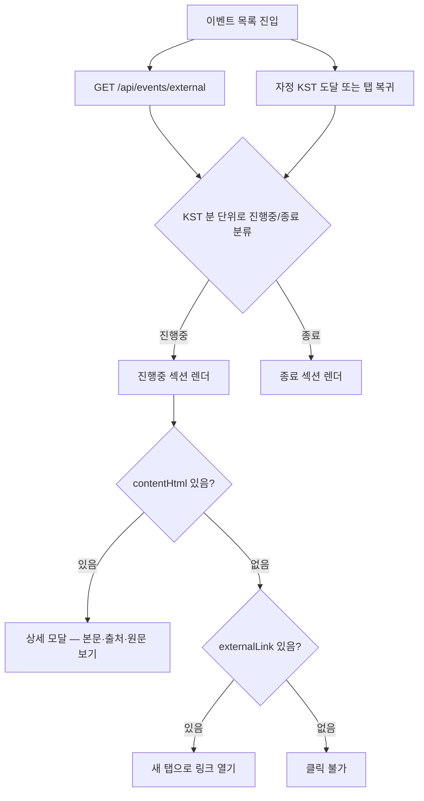
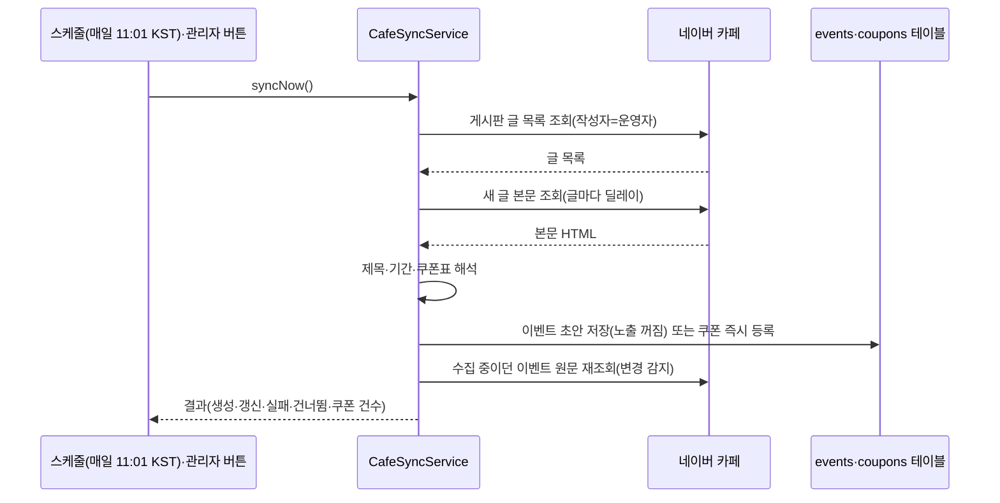

# events — 설계

## 1. 화면 구조

| 화면 ID | 화면 | 영역 배치 |
|---|---|---|
| SC-03-01 | 이벤트 목록(`/events`) | 상단바 → "진행중" 섹션(카드 목록) → "종료" 섹션(카드 목록) → 광고 슬롯(1건 이상 렌더 시에만) |
| SC-01-01 내부 | 관리자 이벤트 관리(`/admin/event`) | 관리자 셸 탭 안 — 목록 표(페이지네이션) + 등록/수정 폼 + 일괄 선택 툴바 |

카드 1개 구성: 이미지·제목·기간 + 상태 뱃지(`StatusBadge` `active`="진행중" / `expired`="종료") + (본문 또는 외부 링크 있으면) 클릭 가능 표시.

카드 클릭 시 `contentHtml` 있으면 상세 모달: 배너 → 제목 → 기간·남은 날 → 본문(`.event-body`) → "출처: 컴투스프로야구 공식 카페" + [원문 보기]. 관리자 이벤트 관리에 "수집함" 필터와 "지금 수집" 버튼, 수집함 행에 "구간 못 찾음"/"원문 변경"/"마감 미확인" 배지·본문 미리보기·승인·본문 갱신.

## 2. 상태

| 상태 | 조건 | 화면에 보이는 것 |
|---|---|---|
| 불러오는 중 | 목록 요청 진행 중 | 섹션별 로딩 표시 |
| 진행중 | `expireAt >= now`(KST 분 단위) | `StatusBadge variant="active"` |
| 종료 | `expireAt < now` | `StatusBadge variant="expired"` |
| 빈 화면 | 두 섹션 다 0건 | 섹션별 빈 상태 문구, 광고 슬롯 미노출 |
| 오류 | 목록 요청 실패 | 섹션별 오류 안내 + 재시도(홈 미리보기는 이 구분이 없음) |
| 관리자 — 상한 도달 | 전체 이벤트가 1000건 초과 | 경고 배너("더 있을 수 있음") |
| 관리자 — 일괄 처리 부분 실패 | 선택 항목 중 일부만 처리됨 | 성공분만 반영 + "N건 처리 실패" 배너 |
| 관리자 — 수집함 | 수집 초안 0건 / 수집 진행 중 / 이미 실행 중 | "수집된 초안이 없습니다" / 버튼 비활성 / 409 안내. 모달은 이미 불러온 목록 데이터만 쓴다 |

## 3. 흐름



관리자 등록/수정 흐름: 폼 저장 → `POST/PATCH /api/admin/events` → 시각 입력을 비웠으면 서버가 기본값(12:00/23:59:59) 채움, 채웠으면 그 값 유지 → 캐시 커밋 전 비움(§ 스펙 REQ-EVT-11).

## 4. 디자인 값

- 상태 뱃지: `PinnedBadge` 아님 — `StatusBadge`의 `active`/`expired` variant, 상태 축 팔레트(`fe-design.md` § 4) 그대로.
- 카드 폭·간격: 기본 모바일 토큰, 도메인 전용 색·여백 토큰 없음. 단 카드 썸네일 높이·제목 글자 크기·정보 영역 padding은 CSS 변수(`--thumb-height` `--title-font-size` `--event-card-info-padding`)로 `EventCard` 기본값을 두고, `EventListHorizontal`/`EventListVertical` 컨테이너가 배치 맥락에 맞춰 오버라이드한다(가로 스크롤 쪽이 더 작은 값).

- `.event-body` 한 곳이 본문 모양을 정한다: 폭 480 이내, 이미지 100%, 표는 가로 스크롤, 색·간격은 `fe-design.md` 토큰만. 모달 안 광고 슬롯 없음.

## 5. 서버와 주고받는 것

| 요청 | 응답 | 실패하면 |
|---|---|---|
| `GET /api/events/external` | 노출 중인 이벤트 배열(OFFICIAL만) | 오류 섹션 표시, 재시도 가능 |
| `POST /api/admin/events` | 등록된 이벤트 | 필수값 비어도 서버 검증이 약해 500이 날 수 있음(§ 스펙 참조) |
| `PATCH /api/admin/events/{id}` | 수정된 이벤트(전체 필드) | 동일 |
| `PATCH .../visible`, `bulk/visible` | 처리 결과 | 일부 실패 시 `failedIds` 기준 배너 |
| `DELETE /api/admin/events/{id}`, `bulk` | 처리 결과 | 일부 실패 시 배너 |
| `GET /api/admin/events` | 페이지네이션된 전체 목록 | 1000건 초과 시 경고 배너 |
| `POST /api/admin/cafe-sync` | 수집 결과 건수(`created`·`updated`·`failed`) | 수집 실패 = `failed` 카운트 알림, 실행 중이면 409 |
| `POST /api/admin/cafe-sync/events/{id}/refresh` | 갱신된 이벤트 1건 | 오류 알림 |
| `GET /api/admin/events?collected=true` | 수집함 목록 | (현 FE 는 전량 조회 후 화면에서 거름) |

## 6. Figma

| 화면 | node-id |
|---|---|
| 이벤트 목록 | 미확인 — Figma 정본 파일 없음 |
| 관리자 이벤트 관리 | 미확인 — 동일 |

## 7. 카페 이벤트 수집 (자동 수집 배치)

컴투스프로야구 공식 네이버 카페의 "진행 중 Event" 게시판에서 운영자(닉네임 "GM드리미")가 올리는 새 글을 읽어 이벤트·쿠폰을 자동으로 만든다(관련 결정 기록: ADR 0009). 매일 정해진 시각과 관리자 "지금 수집" 버튼이 같은 코드를 부른다.

### 7.1 흐름



### 7.2 트리거

| 트리거 | 방식 |
|---|---|
| 자동 | 매일 11:01(한국 시간). `cafe-sync.enabled=false` 면 건너뜀 |
| 수동 | 관리자 이벤트 탭 "지금 수집" 버튼 → `POST /api/admin/cafe-sync`. 자동 실행 여부 설정과 무관하게 항상 동작 |
| 동시 실행 방지 | 서버 1대 기준 메모리 플래그 — 이미 실행 중이면 409(`EVENT_CAFE_SYNC_RUNNING`) |

### 7.3 판정 규칙 (요약)

- 정해진 작성자(운영자)의 글만 본다. 여러 이벤트를 모아 안내하는 "모아보기" 글은 건너뜀
- 쿠폰 번호 표가 있거나 제목에 "쿠폰"이 들어간 글은 이벤트로 만들지 않고 쿠폰만 등록
- 본문에서 "이벤트 기간" 구간을 못 찾으면 이벤트 초안을 만들지 않는다(쿠폰은 이미 등록된 채로 진행)
- 마감 날짜를 알 수 없으면(자리표시 값 2099-12-31) 행을 만들지 않고 다음 실행에서 다시 확인한다
- 이미 손으로 등록해 둔 이벤트와 원문 글번호나 이름이 같으면 새 행을 만들지 않고 그 행에 본문만 채운다(제목·기간·노출 여부는 그대로 둔다)
- 이미 수집한 이벤트는 매번 원문을 다시 읽어, 내용이 달라졌으면 본문을 자동으로 덮지 않고 "원문 변경" 표시만 한다
- 쿠폰은 표에서 이미 공개(발행)된 번호만 등록한다(기한 지남·미발행·형식이 어긋난 행은 건너뜀, 번호가 중복되면 무시)

### 7.4 실패·중복 처리

| 상황 | 처리 |
|---|---|
| 카페 요청 실패(목록·본문 조회) | 1회 자동 재시도. 그래도 실패하면 그 글만 "실패"로 세고 나머지 글은 계속 처리 |
| 본문 이미지 업로드 일부 실패 | "본문 갱신"은 저장을 중단하고 기존 본문을 그대로 유지(반쪽 결과로 덮지 않음) |
| 배치 전체가 예외로 끝남 | 로그만 남기고 사용자 화면에는 영향 없음 — 다음 날 다시 시도 |
| 이벤트도 쿠폰도 아닌 글 | 새 행을 만들지 않되, 최근 45일 안의 글은 매일 다시 훑어 뒤늦게 공개되는 쿠폰 번호를 계속 잡는다 |
| 쿠폰 번호 중복 | 데이터베이스 제약이 조용히 무시(오류 아님) |

### 7.5 API·권한

| 메서드/경로 | 설명 | 권한 |
|---|---|---|
| `POST /api/admin/cafe-sync` | 지금 수집(수동 실행), 결과 건수 반환 | ADMIN |
| `POST /api/admin/cafe-sync/events/{id}/refresh` | 수집한 이벤트 1건의 본문을 원문 기준으로 다시 채움 | ADMIN |

두 API 모두 `/api/admin/**` 하나의 보안 설정으로 관리자 권한을 강제한다(다른 관리자 API와 동일한 방식).

### 7.6 설정 키

`application.properties`에 있다. **값은 전부 비밀이 아닌 공개 식별자**(카페 번호·게시판 번호·운영자 계정 키)다 — 코드 주석에도 명시돼 있다.

| 키 | 기본값 | 의미 |
|---|---|---|
| `cafe-sync.enabled` | `true` (환경변수 `CAFE_SYNC_ENABLED`로 덮어씀) | 매일 자동 실행 여부 — 수동 실행과는 무관 |
| `cafe-sync.cafe-id` | 카페 고유 번호 | 대상 카페 식별 |
| `cafe-sync.cafe-url` | 카페 주소 슬러그 | 글 원문 링크 생성에 사용 |
| `cafe-sync.menu-id` | 게시판 번호 | "진행 중 Event" 게시판 |
| `cafe-sync.member-key` | 운영자 계정 고유 키 | 닉네임이 아니라 이 값으로 작성자를 거른다 |
| `cafe-sync.list-page-size` | `50` | 목록 한 번에 가져오는 글 수 |
| `cafe-sync.request-delay-ms` | `700` | 카페 서버 부담을 줄이기 위한 요청 간 대기(ms) |

### 7.7 스케줄·비동기 방식

- 스케줄 기능 활성화(`@EnableScheduling`)는 분석 이벤트용 비동기 설정 클래스에 함께 얹혀 있다 — 이 기능만을 위한 별도 설정 파일은 없다
- 카페 수집 자체는 전용 스레드풀 없이, 스케줄이 깨우는 스레드(수동 실행이면 그 요청을 처리하는 스레드)에서 순서대로 실행된다
- 네트워크 호출이 길게 걸리는 구간에는 데이터베이스 트랜잭션을 걸지 않는다 — 실제 저장은 건별로 짧게 트랜잭션을 묶는다

## 8. 로컬 개발 환경 셋업

⚠️ **이 프로젝트는 개발·운영이 같은 데이터베이스 인스턴스를 쓴다.** 로컬에서 서버를 띄우면 운영 데이터베이스에 그대로 쓴다 — 카페 수집을 로컬에서 실행하면 실제 이벤트·쿠폰 행이 운영 화면에도 나타난다. 실행 전 확인이 필요하다.

### 8.1 필요한 환경변수 (값은 예시, 실제 값은 팀에서 전달받는다)

| 키 | 예시 | 비고 |
|---|---|---|
| `DB_HOST` / `DB_PORT` / `DB_NAME` / `DB_USERNAME` / `DB_PASSWORD` | `<your-value>` | 운영과 같은 인스턴스 — 개인용으로 새로 만들지 않는다 |
| `NAVER_CLIENT_ID` / `NAVER_CLIENT_SECRET` / `NAVER_REDIRECT_URI` | `<your-value>` | 로그인 기능용, 카페 수집과는 무관 |
| `JWT_SECRET` | `<your-value>` | 32자 이상 |
| `AWS_CREDENTIALS_ACCESS_KEY` / `AWS_CREDENTIALS_SECRET_KEY` / `AWS_REGION_STATIC_VALUE` / `AWS_S3_BUCKET` / `AWS_S3_URL` | `<your-value>` | 수집한 이미지가 이 저장소로 올라간다 — 없으면 이미지 업로드가 전부 실패한다(§ 7.4) |
| `CAFE_SYNC_ENABLED` | `true` 또는 `false` | 로컬에서 매일 자동 실행을 막고 싶으면 `false`. "지금 수집" 버튼·API 호출은 이 값과 무관하게 항상 동작한다 |
| `SWAGGER_UI_ENABLED` | `true` | 로컬에서 API 문서를 보고 싶을 때만(선택) |

카페 번호·게시판 번호·운영자 키(`cafe-sync.*`)는 § 7.6 값이 이미 기본으로 들어 있어 로컬에서 따로 설정할 필요가 없다.

### 8.2 실행 명령

```bash
# 서버 (BE)
cp .env .env.properties   # 이미 있으면 생략
./gradlew bootRun

# 화면 (FE, 다른 터미널)
cd web
npm run dev
```

프로필을 따로 지정하지 않으면 기본 설정(`application.properties`)으로 뜬다. 배포 전용 설정(`application-prod.properties`)은 로컬에서 켜지 않는다.

### 8.3 수집을 손으로 돌려보는 방법

1. 관리자 계정으로 로그인 → 관리자 화면 → 이벤트 탭 → "지금 수집" 버튼
2. 또는 관리자 로그인 상태에서 API를 직접 호출: `POST /api/admin/cafe-sync`
3. 결과는 생성·갱신·실패·건너뜀·쿠폰 등록 건수로 응답한다(§ 7.5)
4. ⚠️ 개발 환경에 따라 네이버 카페 접속이 막혀 있을 수 있다 — 이때는 원문 조회 실패(502)로 끝난다. 코드 문제가 아니라 네트워크 접근 문제일 수 있다(2026-09-30 실측에서도 같은 사유로 실제 카페 호출 검증 못 함 — history.md 참고)

### 8.4 실행 전 확인할 것

- 운영 데이터베이스에 이 기능이 쓰는 컬럼(수집 관련 4개)이 이미 적용돼 있는지 — 적용 전에 서버를 띄우면 이벤트 조회 자체가 실패한다(history.md "미결" 참고)
- 로컬에서 반복 테스트하면 운영 이벤트·쿠폰 데이터가 실제로 쌓인다 — 테스트 후 정리가 필요한지 팀과 확인한다
