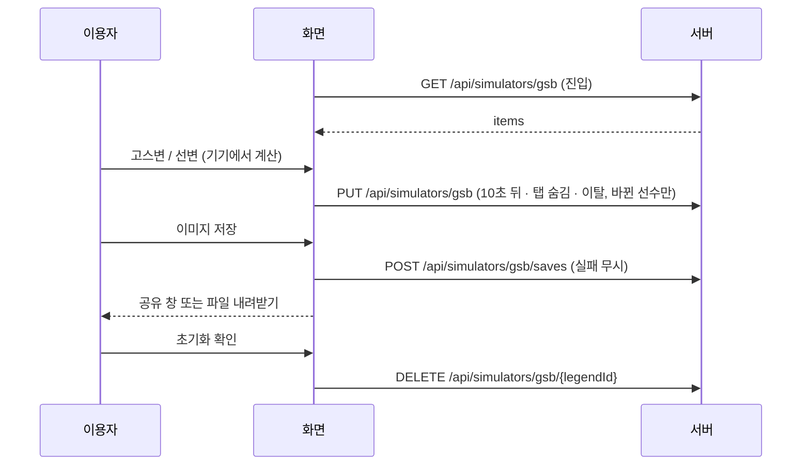

# simulators — 설계

## 1. 화면 구조

| 화면 ID | 화면 | 영역 배치 |
|---|---|---|
| SC-19-01 | 고스변 시뮬레이터 `/simulators/gsb` | 위: 선수 고르기(검색 · 칩 3줄 · 가로 스크롤 카드). 아래: 왼쪽 스킬 카드, 오른쪽 버튼열(고스변 · 선변 · 변경/취소 · 이미지 저장 · 초기화)과 누적 횟수 |

선택 모드 버튼은 3줄(고스변 비활성 / 선변 강조 / 변경·취소)이며 버튼을 숨기지 않는다. 고른 스킬은 테두리로만 구분한다. 두 변경권 버튼은 같은 모양에 색 계열만 다르다(고스변 brand, 선변 플래티넘 금색).

## 2. 상태

| 상태 | 조건 | 화면에 보이는 것 |
|---|---|---|
| 확인 전 | 로그인 확인 중 | 아무것도 그리지 않음(안내 화면 깜빡임 방지) |
| 비로그인 | 로그인 안 함 · 세션 끊김(401) | 로그인 안내 + 예시 카드 |
| 불러오는 중 | 선수 · 기록 조회 중 | 골격 6줄 |
| 오류 | 조회 실패 | 오류 상자 + 다시 시도 |
| 빈 | 선수를 아직 안 고름 | "위에서 레전드 선수를 골라 보세요." |
| 정상 | 선수 선택됨 | 스킬 카드 · 버튼 · 누적 횟수. 스킬이 없으면 "고급 고유능력 변경권을 눌러 스킬을 뽑아 보세요" |

## 3. 흐름

## 4. 디자인 값

신규 토큰 `--color-grade-platinum-alpha-15`(선변 버튼 면). 선변 금색 사용은 `fe-design-audit.md` § 5 예외. 나머지는 기존 토큰.

## 5. 서버와 주고받는 것

| 요청 | 응답 | 실패하면 |
|---|---|---|
| `GET /api/simulators/gsb` | `{ items: [{ legendId, gsbCount, selCount, skillIds[3] }] }` | 401 안내 화면 · 그 밖 오류 상자 |
| `PUT /api/simulators/gsb` `{ items }` (1~100) | `{ saved }` | 변경 목록 유지, 다음 트리거에 재시도 |
| `DELETE /api/simulators/gsb/{legendId}` | `{ deleted }` | 오류 처리 |
| `POST /api/simulators/gsb/saves` | `{ id }` | 무시(이미지 저장은 계속) |

저장소: Valkey Hash `{접두}:sim:gsb:{userId}:{이메일|noemail}`, 필드 = 레전드 id, TTL 30일. 테이블 `site_user_simulator_saves`: id · user_id(site_users.id, 탈퇴 시 삭제) · legend_id · gsb_count · sel_count · skill_id_1~3 · created_at, 인덱스 (user_id, created_at). 생성문은 `sql/draft/pending/site_user_simulator_saves.sql` — 사용자가 직접 실행하기 전까지 운영에 없다. 스킬 카드는 `global/ui/skillCard` 로 옮겨 레전드 재료 화면과 함께 쓴다.

## 6. Figma

파일 `VCVQzOpSIpwpZw11gxG7N1`, Section `640:3504`.

| 화면 | node-id |
|---|---|
| 01 메인 | `648:3649` |
| 01-D 다크 | `648:3730` |
| 02 선변 선택 전 | `648:3811` |
| 03 선변 선택 후 | `648:3896` |
| 04 저장 카드 | `641:3523` |
| 05 비로그인 | `641:3554` |
| 06 초기화 확인 | `641:3585` |
