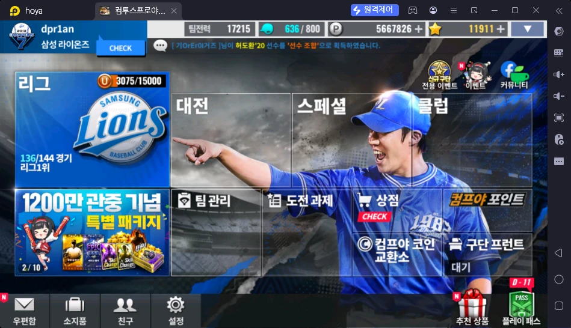
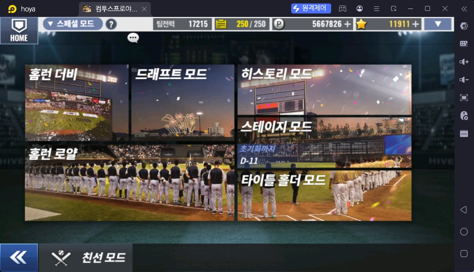
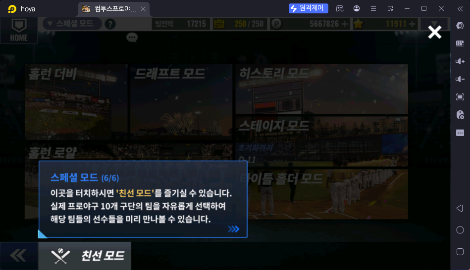

# 컴투스프로야구 콘텐츠 지도 (공략 글 기획용 초안)

작성일 2026-10-17 · 용도: `articles` 공략 글을 "어떤 글을, 어느 카테고리에, 몇 편" 쓸지 정하는 밑그림
기준 문서: `docs/features/articles/spec.md` (카테고리 초안 5개, 초기 목표 15편, 글 1편 1,200자·이미지 3장)

## 읽는 법

| 표시 | 뜻 |
|---|---|
| 근거 있음 | 저장소 파일에서 확인한 사실. 근거 칸에 파일을 적었다 |
| 🟨 | 일반 상식 수준의 짐작. 운영자가 한 번 훑고 틀리면 고쳐 주면 된다 |
| ❓ | 저장소에 근거가 없다. 비워 두었고 5번 질문 목록에 모았다. 보상 수량·해금 조건·확률·주기는 전부 이 방식으로 처리했다 |
| 스샷 | 로비 스크린샷에서 눈으로 확인한 것 (메뉴 이름, 숫자) |

⚠️ 로비 스크린샷은 메뉴 이름만 알려 준다. 메뉴 안쪽 구성(하위 모드, 보상)은 사진에 없으므로 대부분 🟨 또는 ❓ 이다.

---

## 1. 콘텐츠 목록 (로비 메뉴 순)

하위 행은 `└` 로 표시한다.

| # | 콘텐츠 | 무엇인가 | 하는 방법 | 얻는 보상 | 보상 활용처 | 주기 | 초보 우선도 | 사이트 근거 or ❓ |
|---|---|---|---|---|---|---|---|---|
| 1 | 리그 | 정규 시즌 형식으로 경기를 치르는 기본 모드 🟨. 스샷에 "136/144 경기", "리그 1위" 표시 | 경기를 진행해 144경기를 채운다 🟨 | ❓ | ❓ | 시즌 ❓ | 상 | 스샷. 보상·시즌 길이 ❓ |
| 2 | └ 리그 포인트 | 로비 리그 칸의 "3075/15000" 게이지 | 경기를 하면 쌓임 🟨 | ❓ (15000 도달 시) | ❓ | ❓ | 중 | 스샷. 뜻과 보상 ❓ |
| 3 | 대전 | 대전 모드 메뉴. 하위 5개 (게임 안 안내 문구 확인) | 로비 → 대전 | ❓ | ❓ | ❓ | 중 | 스샷(대전 모드 안내 1~5/5) |
| 4 | └ 랭킹 대전 | 내 리그의 팀들과 겨루는 대전. 한 주 단위 리그에서 순위를 다투고 보상을 받는다 | 대전 → 랭킹 대전 | 주간 순위 보상 ❓ | ❓ | 주 | 상 | 스샷(1/5) |
| 4-1 | └ 랭킹 토너먼트 | 최고의 구단을 가리는 1024강 토너먼트. 1·4·7·10월, 연 4회 열린다 (예: 26년 4차, 128강 진행 중) | 대전 → 랭킹 토너먼트 | ❓ | ❓ | 분기(연 4회) | 중 | 스샷(2/5) |
| 5 | └ 친구 대전 | 친구의 팀과 겨루는 대전. **매일 스타(★) 최대 60개를 모으는 수급처.** 상한을 채운 뒤엔 우정포인트 | 대전 → 친구 대전 → 상대 선택 → 게임 시작 (연속경기 가능) | 스타(승리당 5~25, 하루 상한 20~60) · 우정포인트(친구당 100) | 우정포인트 → 우정 상점 (`contents/대전/친구대전.md`) | 일 (매일 초기화) | 상 | 스샷 + 운영자 설명. 상세 `contents/대전/친구대전.md` |
| 5-1 | └ 페넌트레이스 모드 | 시뮬레이션으로 진행하는 리그 승강제 모드. 한 주 동안 144경기 결과로 순위를 다툰다. 토요일에 공격전이 열린다 | 대전 → 페넌트레이스 모드 | ❓ | ❓ | 주 (토요일 공격전) | 중 | 스샷(4/5) |
| 5-2 | └ 실시간 대전 | 다른 이용자와 실시간 1대1 대전. 하는 사람이 거의 없지만 초반에는 챙기면 좋다 | 대전 → 실시간 대전 | ❓ | ❓ | ❓ | 초반 상 · 이후 하 | 스샷(5/5) + 운영자 설명 |
| 6 | 스페셜 | 스페셜 모드 메뉴. 하위 6개 + 하단 친선 모드 (게임 안 안내 1~6/6) | 로비 → 스페셜 | ❓ | ❓ | ❓ | 중 | 스샷(스페셜 모드 화면 + 안내 1~4/6) |
| 6-1 | └ 홈런 더비 | 일주일 단위 홈런더비 리그. 점수로 순위를 다투고, 리그가 끝나면 등급에 따라 홈런 코인을 받는다 | 스페셜 → 홈런 더비 → 타자·아이템 고르고 게임 시작 (1경기 = 볼 1개) | 홈런 코인 (리그 등급별) | 홈런 상점 (구단 성장 아이템) | 주 (목 06:00 ~ 다음 주 수 23:59) | ❓ | 스샷(홈런더비 안내 1~5/5). 상세 `contents/스페셜/홈런더비.md` |
| 6-2 | └ 홈런 로얄 | 다른 구단주들과 실시간으로 겨루는 홈런 더비 대전. 1주 시즌, 하루 2번(11~14시, 17~20시) 열림 | 스페셜 → 홈런 로얄 → 로비 입장 (1경기 = 볼 1개, 6분마다 충전) | 경기마다 홈런 코인 · 파트당 3경기 참여 보상 ★10 · 시즌 보상 ★10~1,000 (월 00:01 수령) | 홈런 상점 | 일 2회 / 주 시즌 | ❓ | 상세 `contents/스페셜/홈런로얄.md` |
| 7 | └ 히스토리 모드 | 실제 과거 시즌 로스터를 상대로 하루에 한 라운드씩 도는 모드. 70라운드 × 25인 로스터, 14일 주기(1일차=월요일) | 스페셜 → 히스토리 모드. 매일 해당 일차 라운드를 진행. 레전드 재료 카드가 일차마다 나옴 | 레전드 재료 카드 등 (정확한 보상표 ❓) | 레전드 만들기(# 14) | 14일 주기 | 상 | `docs/features/historyLegend/spec.md` REQ-HL-01·06, `legendCollections` REQ-LCOL-19. 위치: 스페셜 모드 안 (스샷 3/6). 게임 안내: "다양한 팀들과의 대결을 통해 팀 전력을 확인" |
| 7-1 | └ 스테이지 모드 | 스테이지 14개(일반 8 + 히든 6)를 아래부터 차례로 깬다. 대결마다 미션 3개, 전체 별 177개. 주기적 초기화 후 다시 도전 | 스페셜 → 스테이지 모드 → 난이도 선택 → 대결 | 스테이지별 클리어 보상 (팩·권·스타) | ⏸ | 월 1회 초기화 | ❓ | 상세 `contents/스페셜/스테이지모드.md` |
| 7-2 | └ 드래프트 모드 | ❓ (스페셜 안내 1~6/6 에 설명 없음) | 스페셜 → 드래프트 모드 | ❓ | ❓ | ❓ | ❓ | 스샷(메뉴 이름만) |
| 7-3 | └ 타이틀 홀더 모드 | 내 타자 1명만 직접 치며 36경기 리그를 회차로 반복. 최고 회차의 TH 포인트로 주간 순위 | 스페셜 → 타이틀 홀더 → 타자 등록 → 입장 | 경기·시상·주간 랭킹 TH 코인 | TH 상점 (고유능력 선택 변경권) | 주 (월 06:00 ~ 일 23:59) | ❓ | 상세 `contents/스페셜/타이틀홀더모드.md` |
| 7-4 | └ 친선 모드 | 실제 프로야구 10개 구단 팀을 자유롭게 골라 그 팀 선수들을 미리 만나 보는 모드 | 스페셜 → 친선 모드(왼쪽 아래 버튼) | ❓ (보상 없음 🟨) | — | 상시 🟨 | 하 🟨 | 스샷(6/6) |
| 9 | 클럽 | 이용자끼리 모이는 모임 🟨 | ❓ | ❓ | ❓ | ❓ | 하 | 스샷. ❓ |
| 10 | 팀 관리 | 선수 카드 보유·라인업·강화를 다루는 곳 🟨 | ❓ | — | — | — | 상 | 스샷. 세부 ❓ |
| 11 | └ 라인업·덱 구성 | 타자·투수 카드로 팀을 짠다 🟨. 팀전력 17215 이 상단에 표시 | 카드를 배치 | — | 경기력 | — | 상 | 팀전력 계산법 ❓. 카드 종류(노말·히어로·플래티넘·레전드)는 `guides/content/playerSkillsGuide.js` |
| 12 | └ 선수 강화·등급 | 카드를 키워 능력치(타자 정확·파워·선구·주력·수비, 투수 제구·구위·체력·직구·변화)를 올림 🟨 | ❓ | — | 팀전력 | — | 상 | 능력치 이름은 `guides/content/playerEncyclopedia.js`. 강화 방법·비용 ❓ |
| 13 | └ 스킬(고유능력) 등록·강화 | 카드마다 스킬 3칸. 등급 E~S+ 7단계. 기본 강화 7회, 이후 고추강·고고각 재화로 올림 | 스킬 3개 고르고 등급 올림 | — | 팀전력·경기력 | — | 상 | `legendCollectionSkills` REQ-LCSK-02~06, `guides/content/playerSkillsGuide.js`. 고추강·고고각 얻는 곳 ❓ |
| 14 | └ 레전드 만들기 | 레전드 카드 1장 = 재료 선수 6칸 + 코치 2칸(총 8칸). 코치는 6장 중 아무 1장. 레전드 74명 | 재료 카드를 모아 삽입 | 레전드 카드 | 팀 핵심 전력 | — | 상 | `legendCollections` REQ-LCOL-03·04·16, `legendStats` |
| 15 | 도전 과제 | 조건 달성 시 보상을 받는 목록 🟨 | 조건 달성 | ❓ | ❓ | ❓ | 중 | 스샷. 하위에 "컬렉션 › 레전드 컬렉션" 이 있음(# 16) |
| 16 | └ 컬렉션 › 레전드 컬렉션 | 레전드 카드의 보유·액자(전시) 상태를 확인하는 곳 | 레전드를 만들면 기록됨 | ❓ | ❓ | — | 중 | `legendCollections` REQ-LCOL-05·21 (보유중/액자 상태, 획득일 확인 위치) |
| 17 | 상점 | 재화로 카드·아이템을 사는 곳 🟨 ("CHECK" 표시는 새 상품 알림 🟨) | ❓ | 카드·아이템 | 팀 강화 | 상품별 ❓ | 상 | 스샷. 상품 목록 ❓ |
| 18 | └ 선수팩·뽑기류 | 확률로 카드를 얻는 상품. 공시 분류: 선수팩, 장비·럭키백, 고유능력, 강화·등급, 스카우트·드래프트, 카드 조합, 이벤트, 스킨·마스코트 | ❓ | 카드 | 팀 강화 | ❓ | 상 | `guides/content/probabilityGuide.js` (분류만). 실제 확률은 `/probability` 화면 |
| 19 | └ 마일리지 상점·뽑기 | 마일리지로 재료 노말 카드를 **지목해서** 살 수 있음("저격"). L마크 카드가 레전드 재료 | 상점에서 해당 카드 구매 | 레전드 재료 카드 | 레전드 만들기 | 상점 갱신 ❓ | 상 | `docs/features/mileage/spec.md`, `guides/content/mileageSniping.js`. 마일리지 쌓는 법 ❓ |
| 20 | 컴프야 포인트 | 로비 큰 버튼. 사이트 이름 "컴프야펀"과 다른 게임 내 메뉴 | ❓ | ❓ | ❓ | ❓ | 중 | 스샷. 전부 ❓ |
| 21 | 컴프야 코인 교환소 | 코인으로 아이템을 바꾸는 곳 🟨 | ❓ | 교환 아이템 ❓ | — | ❓ | 중 | 스샷. 코인 얻는 법 ❓ |
| 22 | 구단 프런트 | 로비에 "대기" 라고 표시. 시간이 걸리는 보상형 콘텐츠 🟨 | ❓ | ❓ | ❓ | ❓ | 중 | 스샷. 전부 ❓ |
| 23 | 이벤트 · 전용 이벤트(신규 구단) | 기간 한정 보상 콘텐츠. 신규 이용자용 "전용 이벤트" 아이콘이 따로 있음 | 이벤트별로 다름 | 이벤트별 | — | 기간 한정 | 상 | 사이트 `/events` (`docs/features/events/spec.md`, `guides/content/eventGuide.js`). 신규 구단 전용 이벤트 내용 ❓ |
| 24 | 쿠폰 | 코드를 입력해 보상을 받는다 | 게임 안에서 쿠폰 코드 등록 | 쿠폰별 | — | 수시 | 상 | `/coupons`, `guides/content/couponGuide.js`. 게임 내 입력 위치 ❓ |
| 25 | 커뮤니티 | 공식 카페 등 소식 창구 🟨 (스샷의 우측 상단 아이콘) | 링크로 이동 | 정보 | — | — | 하 | 스샷, `guides/content/noticeGuide.js`(공식 카페 공지) |
| 26 | 우편함 | 보상·지급 아이템이 도착하는 곳 🟨 | 수령 | — | — | 보관 기간 ❓ | 상 | 스샷. 보관 기간 ❓ |
| 27 | 소지품 | 가진 아이템 보관함 🟨 | — | — | — | — | 중 | 스샷 |
| 28 | 친구 | 친구 추가·교류 🟨 | ❓ | 친구 포인트 같은 보상 ❓ | ❓ | 일 ❓ | 하 | 스샷. ❓ |
| 29 | 설정 | 환경설정. 쿠폰 입력이 여기에 있을 수도 있음 ❓ | — | — | — | — | 하 | 스샷 |
| 30 | 추천 상품 · 특별 패키지 | 유료 상품. 로비에 "1200만 관중 기념 특별 패키지 2/10"(구매 횟수 표시 🟨) | 결제 | 패키지별 | — | 기간 한정 🟨 | 하 | 스샷. 유료 상품은 글로 권유하지 않고 구성 소개 정도로만 🟨 |
| 31 | 플레이 패스 | 기간제 보상 패스. 로비에 "D-11" 표시 🟨 | 플레이하며 단계 보상 수령 🟨 | 단계별 보상 ❓ | ❓ | 시즌제 🟨 | 중 | 스샷. 가격·보상 ❓ |
| 32 | 확률 공시 | 게임이 공개한 뽑기 확률 정보 | 게임 안 정보공개 페이지 | — | 뽑기 판단 | 구성 변경 시 | 중 | `/probability`, `guides/content/probabilityGuide.js` |

⚠️ 사이트 근거가 충분한 행은 7·13·14·16·19·24·32 정도다. 나머지는 메뉴 이름만 확인된 상태다.

---

## 1-1. 콘텐츠 상세 (콘텐츠마다 파일 하나)

게임 메뉴 구조 그대로 `contents/{카테고리}/{콘텐츠}.md` 에 둔다. **여러 콘텐츠가 같이 쓰는 상점은 `contents/상점/` 에 한 번만 적고 콘텐츠 파일은 링크만 한다.** 파일마다 같은 순서: 한 줄 요약 · 하는 방법 · 보상 · 보상 활용처 · 운영자 평가·초보 팁 · 확인 필요

| 카테고리 | 콘텐츠 | 상태 |
|---|---|---|
| 대전 | [랭킹 대전](contents/대전/랭킹대전.md) | 뼈대 |
| 대전 | [친구 대전](contents/대전/친구대전.md) | **상세** (스타 표 · 우정 상점) |
| 대전 | [랭킹 토너먼트](contents/대전/랭킹토너먼트.md) | 뼈대 |
| 대전 | [페넌트레이스 모드](contents/대전/페넌트레이스모드.md) | 뼈대 |
| 대전 | [실시간 대전](contents/대전/실시간대전.md) | 뼈대 |
| 스페셜 | [홈런 더비](contents/스페셜/홈런더비.md) | **상세** (주간 보상 · 홈런 상점) |
| 스페셜 | [홈런 로얄](contents/스페셜/홈런로얄.md) | **상세** (운영 시간 · 참여 보상) |
| 스페셜 | [히스토리 모드](contents/스페셜/히스토리모드.md) | **상세** (일일 루틴 · 포인트 계산 · 게릴라 뽑기 · 4장 저격) |
| 스페셜 | [스테이지 모드](contents/스페셜/스테이지모드.md) | **상세** (보상표 · 대결 53개·미션 159개 · 히든 재설정) |
| 스페셜 | [타이틀 홀더 모드](contents/스페셜/타이틀홀더모드.md) | **상세** (TH 포인트 · 회차 목표 · 주간 보상) |
| 상점 (공용) | [홈런 상점](contents/상점/홈런상점.md) | **상세** — 홈런 더비 · 홈런 로얄이 같이 쓴다 |
| 상점 | [TH 상점](contents/상점/TH상점.md) | **상세** — 타이틀 홀더 모드 |
| 상점 | [히스토리 상점](contents/상점/히스토리상점.md) | **상세** — 히스토리 모드 |

## 1-2. 공통 스크린샷

**로비 화면**

**스페셜 모드 메뉴**

**스페셜 모드 안내 6/6 — 친선 모드**

## 2. 재화·재료 흐름

| 재화·재료 | 어디서 얻나 | 어디에 쓰나 | 근거 |
|---|---|---|---|
| 팀전력 (17215) | 라인업·선수 능력으로 결정 🟨 | 숫자만 표시되는 지표 🟨 | 스샷. 계산식 ❓ |
| 행동력 (636/800) | ❓ (시간 회복 🟨) | ❓ (경기 시작 시 소모 🟨). 이름도 아이콘만 보고 추정 | 스샷. ❓ |
| P (5,667,826) | ❓ (경기·판매 🟨) | ❓ (선수 강화 🟨) | 스샷. 이름·용도 ❓ |
| 별 (11,911) | ❓ | ❓ | 스샷. 이름·용도 ❓. 스킬 기록 spec 에 "스타 경험치" 단어가 있으나 같은 재화인지 불명 |
| 리그 포인트 (3075/15000) | 리그 경기 🟨 | ❓ | 스샷 |
| 마일리지 | ❓ | 마일리지 상점에서 레전드 재료 카드 지목 구매 | `mileage` spec. 얻는 법 ❓ |
| 컴프야 포인트 | ❓ | ❓ | 스샷 |
| 컴프야 코인 | ❓ | 코인 교환소 🟨 | 스샷 |
| 레전드 재료 카드 (선수 6 + 코치 2) | 히스토리 모드 일차별 로스터, 마일리지 상점 | 레전드 만들기 | `historyLegend`, `mileage`, `legendCollections` |
| 기본 강화 7회 | 스킬 등록 후 기본 지급 | 스킬 등급을 한 단계씩 올림 | `legendCollectionSkills` REQ-LCSK-04 |
| 고추강 | ❓ | 기본 강화 7회를 다 쓴 뒤 스킬 1단계 상승 | REQ-LCSK-04. 얻는 곳 ❓ |
| 고고각 | ❓ | 레전드 스킬 A → S 로 올릴 때 사용 | REQ-LCSK-04. 얻는 곳 ❓ |
| 쿠폰 보상 | 쿠폰 코드 | 쿠폰별 | `/coupons`. 내용은 쿠폰마다 다름 |

---

## 3. 덱 성장 순서 뼈대

사이트에 "덱 성장 순서"를 직접 다룬 근거는 없다. 근거가 있는 항목만 확정하고 나머지는 운영자가 채운다.

| 단계 | 이 시기에 할 것 | 아낄 것 | 근거 |
|---|---|---|---|
| 초보 | 튜토리얼·리그 진행으로 기본 덱 완성 ❓. 쿠폰·이벤트 보상을 빠짐없이 수령(사이트 홈에서 확인). 신규 구단 전용 이벤트 확인 🟨 | 뽑기 재화를 아무 팩에나 쓰지 않기 🟨 (구체 기준 ❓) | 쿠폰·이벤트는 사이트 근거. 나머지 ❓ |
| 중급 | 히스토리 모드를 매일 돌며 레전드 재료 모으기. 마일리지로 지목 구매 가능한 재료부터 확인. 목표 레전드 1명 정하기 | 마일리지·재료를 목표 없이 쓰지 않기 | `guides/content/legendMaterialPriority.js` (평점 × 획득 난이도, 하루만 나오는 재료 우선) |
| 고급 | 레전드 스킬 3칸 구성과 강화(기본 강화 → 고추강 → 고고각) 완성. 추천 스킬 조합 반영 | 고추강·고고각을 스킬 구성이 정해지기 전에 쓰지 않기 🟨 | `legendCollectionSkills` REQ-LCSK-02·04·05 (추천 스킬 표 포함) |

초보 → 중급 → 고급으로 넘어가는 기준(팀전력 몇 이상, 레전드 몇 장 등)은 ❓ 이다.

---

## 4. 공략 글 후보 목록 (28편)

카테고리는 `articles` spec 의 5개를 쓴다. 기존 `guides` 12편은 "사이트 화면 사용법"이고, 여기 후보는 "게임을 어떻게 하느냐"라서 겹치지 않게 제목을 잡았다. 우선순위: **가** = 사이트 근거가 충분해 바로 쓸 수 있음 / **나** = 운영자 답변이 있어야 쓸 수 있음 / **다** = 나중에.

### 초보 입문 (6편)

| # | 제목 | 다룰 콘텐츠 | 내부 링크 | 필요한 스크린샷 | 우선순위 |
|---|---|---|---|---|---|
| 1 | 컴프야 처음 시작하면 로비에서 먼저 눌러야 할 메뉴 7가지 | 로비 전체(# 1~32) | `/guides/start` | 로비 전체, 우편함, 상점, 도전 과제 | 나 (메뉴 설명 ❓) |
| 2 | 초보가 하루 10분 안에 끝내는 일일 루틴 | 리그, 우편함, 이벤트, 히스토리 모드 | `/events`, `/history-mode/legend` | 로비, 우편함, 히스토리 모드 화면 | 나 (일일 보상 ❓) |
| 3 | 리그 모드 기본: 144경기와 리그 포인트 | # 1·2 | `/guides/start` | 리그 로비 칸, 리그 경기 화면 | 나 |
| 4 | 대전 모드 입문: 랭킹 대전·토너먼트·친구 대전·페넌트레이스·실시간 대전 한눈에 보기 | # 3~5-2 | 없음 | 대전 모드 메뉴, 안내 문구 5장 | 가 |
| 5 | 행동력이 모자랄 때: 행동력·P·별 재화 정리 | 상단 재화 | 없음 | 상단 재화 막대, 행동력 설명 창 | 나 (용도 ❓) |
| 6 | 초보가 뽑기 전에 꼭 확인할 것: 확률 공시 보는 법 | # 18·32 | `/probability`, `/guides/probability-guide` | 상점 뽑기 화면, 확률 공시 화면 | 가 |

### 레전드·히스토리 (5편)

| # | 제목 | 다룰 콘텐츠 | 내부 링크 | 필요한 스크린샷 | 우선순위 |
|---|---|---|---|---|---|
| 7 | 레전드 카드는 어떻게 만드나: 재료 8칸 한눈에 정리 | # 14 | `/legend-stats`, `/legend-collections` | 레전드 재료 화면 | 가 |
| 8 | 히스토리 모드 14일 주기 이해하기 | # 7 | `/history-mode/legend` | 히스토리 모드 라운드 화면 | 가 |
| 9 | 히스토리 모드에서 레전드 재료 찾는 법 | # 7 | `/history-mode/legend` | 라운드별 로스터 | 가 |
| 10 | 레전드 재료, 뭐부터 모을까: 우선순위 정하는 3가지 기준 | # 14·19·7 | `/legend-stats`, `/mileage`, `/history-mode/legend` | 평점표, 마일리지 상점 | 가 |
| 11 | 레전드 컬렉션(액자)이란? 보유와 액자의 차이 | # 16 | `/legend-collections` | 도전 과제 › 컬렉션 화면 | 나 (게임 내 설명 ❓) |

### 마일리지·재화 (6편)

| # | 제목 | 다룰 콘텐츠 | 내부 링크 | 필요한 스크린샷 | 우선순위 |
|---|---|---|---|---|---|
| 12 | 마일리지로 필요한 재료 카드만 콕 집어 사는 법 | # 19 | `/mileage` | 마일리지 상점 | 가 |
| 13 | 마일리지는 어떻게 모을까 | # 19 | `/mileage` | 마일리지 획득 화면 | 나 (획득처 ❓) |
| 14 | 컴프야 코인 교환소, 무엇과 바꿔야 이득일까 | # 21 | 없음 | 교환소 목록 | 나 |
| 15 | 컴프야 포인트는 어디에 쓰나 | # 20 | 없음 | 컴프야 포인트 화면 | 나 |
| 16 | 구단 프런트 시작 가이드 | # 22 | 없음 | 구단 프런트 화면 | 나 |
| 16-1 | 친구 대전으로 매일 스타 60개 받기 + 우정 상점에서 꼭 살 것 | # 5, `contents/대전/친구대전.md` | `/probability` (팩 확률) | 친구 대전 화면, 팀전력별 스타 표, 우정 상점 3장 | 가 |

### 선수·스킬 (6편)

| # | 제목 | 다룰 콘텐츠 | 내부 링크 | 필요한 스크린샷 | 우선순위 |
|---|---|---|---|---|---|
| 17 | 카드 등급 총정리: 노말·히어로·플래티넘·레전드 | # 11·13 | `/players`, `/skills` | 카드 등급별 예시 | 가 |
| 18 | 타자 능력치 5가지, 무엇을 먼저 올릴까 | # 12 | `/players` | 타자 카드 상세 | 나 (우선순위 판단 ❓) |
| 19 | 투수 능력치 5가지와 구종 등급 읽는 법 | # 12 | `/players` | 투수 카드 상세, 구종 표시 | 나 (구종 설명 ❓) |
| 20 | 스킬 등급 E~S+ 이해하기 | # 13 | `/skills` | 스킬 목록 | 가 |
| 21 | 레전드 스킬 3칸 추천 조합 (타자·투수) | # 13 | `/skills`, `/legend-collection-skills` | 스킬 등록 화면 | 가 (추천 목록이 spec 에 있음) |
| 22 | 스킬 강화 순서: 기본 강화 7회 → 고추강 → 고고각 | # 13 | `/legend-collection-skills` | 스킬 강화 화면 | 가 (획득처는 ❓ 이라 쓰지 않음) |

### 이벤트·쿠폰 활용 (6편)

| # | 제목 | 다룰 콘텐츠 | 내부 링크 | 필요한 스크린샷 | 우선순위 |
|---|---|---|---|---|---|
| 23 | 쿠폰 코드, 게임 안에서 입력하는 방법 | # 24 | `/coupons` | 쿠폰 입력 창 | 나 (입력 위치 ❓) |
| 24 | 쿠폰·이벤트·공지를 놓치지 않는 확인 순서 | # 23~25 | `/coupons`, `/events`, `/notices` | 사이트 홈 | 가 |
| 25 | 신규 구단 전용 이벤트 활용법 | # 23 | `/events` | 전용 이벤트 화면 | 나 |
| 26 | 이벤트 보상 고르는 기준 | # 23 | `/events` | 이벤트 보상 목록 | 나 |
| 27 | 플레이 패스, 사야 할까? | # 31 | 없음 | 플레이 패스 화면 | 다 (유료, 판단 근거 ❓) |
| 28 | 우편함 보상 챙기기와 보관 기간 | # 26 | `/notices` | 우편함 | 나 |

집계: **가 11편 · 나 16편 · 다 1편.** 5개 카테고리 모두 3편 이상이고, 지금 근거만으로 바로 쓸 수 있는 "가" 글은 11편이라 목표 15편에는 4편이 모자란다.

---

## 5. 운영자가 채울 항목 (❓ 모음)

답은 짧은 문장이나 숫자면 충분하다. 모르는 칸은 "모름"이라고만 적어도 된다.

### 가장 먼저 (글 28편 중 막힌 것이 가장 많이 풀리는 질문)

1. 일일로 반드시 하는 일 목록은? (예: 우편함 수령 → 리그 몇 경기 → 히스토리 모드 1라운드)
2. 상단 재화 네 개의 정확한 이름과 용도는? (초록 헬멧 636/800, P 5,667,826, 별 11,911, 팀전력)
3. 히스토리 모드는 로비 어느 메뉴(스페셜인지) 아래에 있나? 거기서 나오는 보상은?
4. 마일리지는 어디서 어떻게 모으나? 1회당 얼마인가?
5. 초보 → 중급 → 고급을 가르는 기준이 있다면? (팀전력, 레전드 보유 수 등)

### 리그 · 대전 · 스페셜 · 클럽

6. 리그: 시즌은 몇 주(또는 몇 일)인가? 144경기 완주·순위 보상은?
7. 리그 포인트 15000 을 채우면 무엇을 받나?
8. 대전 모드 5개의 보상은 각각 무엇인가? (랭킹 대전 주간 보상 · 토너먼트 라운드별 보상 · 페넌트레이스 승강 보상 · 실시간 대전 보상) 페넌트레이스 "토요일 공격전"은 무엇인가?
9. 스페셜 안에 히스토리 모드 말고 어떤 모드가 있나?
10. 클럽은 가입 조건과 얻는 혜택이 무엇인가?

### 팀 관리 · 선수

11. 라인업 구성 규칙(타자 몇 명, 투수 몇 명)과 팀전력 계산 방식은?
12. 선수 강화 방법과 비용은? 노말·히어로·플래티넘·레전드 카드는 각각 어떻게 얻나?
13. 구종 등급은 어떤 종류가 있고 어떻게 올리나?
14. 고추강, 고고각은 어디서 얻나?
15. 초보가 처음 키워야 할 카드는 어떤 종류인가?

### 도전 과제 · 상점 · 재화

16. 도전 과제의 큰 분류와 초보가 먼저 깰 과제는? 컬렉션 › 레전드 컬렉션 달성 보상은?
17. 상점의 탭 구성과, 초보가 사도 되는 것 · 아껴야 하는 것은?
18. 컴프야 포인트의 정체와 얻는 법·쓰는 곳은?
19. 컴프야 코인은 어떻게 얻고 교환소에서 무엇이 가장 이득인가?
20. 구단 프런트는 무엇이고, "대기" 표시는 무슨 뜻인가?

### 이벤트 · 쿠폰 · 기타

21. 신규 구단 전용 이벤트의 내용과 기간은?
22. 쿠폰 코드는 게임 안 어디에 입력하나? (설정? 우편함?)
23. 우편함 보관 기간은? 친구에게 보내는 선물·포인트가 있나?
24. 플레이 패스: 무료·유료 보상 단계와 초보에게 추천하는지?
25. "1200만 관중 기념 특별 패키지"는 상시 상품인지 기간 한정인지, 구매 한도 "2/10"의 뜻은? (유료 상품은 글에 넣을지도 정해 주세요)

### 글 작성 방식

26. 스크린샷은 운영자가 직접 찍은 것을 쓰면 되나? (spec REQ-ART-28 독창성 기준) 닉네임·계정 정보는 가려야 하나?
27. 위 질문에 "모름" 인 콘텐츠는 글로 쓰지 않고 후보 목록의 "다" 로 내릴까요?
