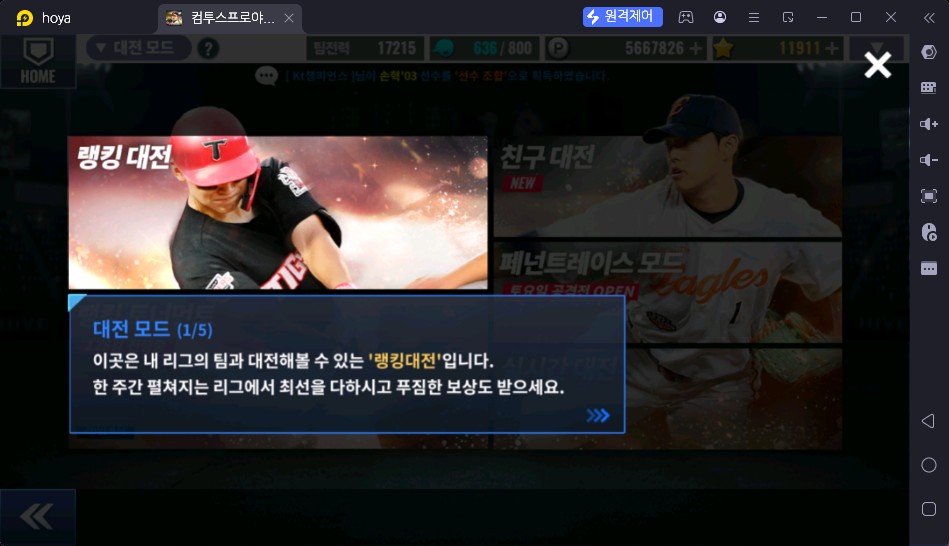

# 랭킹 대전 (대전 → 랭킹 대전)

> 출처: 대전 모드 안내 1/5 (2026-10-17). 아직 상세 자료 없음 — 스샷·설명을 받으면 채운다

## 한 줄 요약

내 리그의 팀들과 겨루는 대전. 한 주 동안 펼쳐지는 리그에서 순위를 다투고 보상을 받는다

## 하는 방법

- 대전 → 랭킹 대전
- ❓

## 보상

- 주간 순위 보상 ❓
- 주기: 주

## 보상 활용처

- ❓

## 운영자 평가 · 초보 팁

- ❓ (우정 상점에 "랭킹 볼" 600 우정포인트 · 주 15회)

## 스크린샷

**대전 모드 안내 1/5 — 랭킹 대전**

## 확인 필요

- ❓ 보상 종류·수량, 입장 횟수(볼·행동력), 초보 우선도
