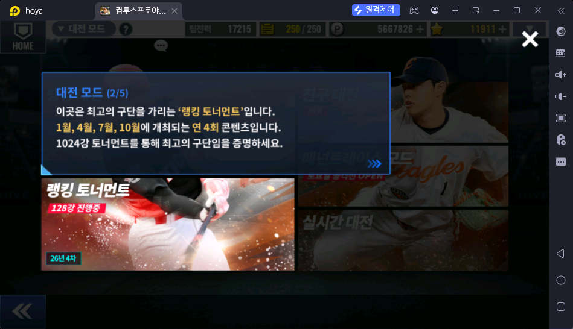

# 랭킹 토너먼트 (대전 → 랭킹 토너먼트)

> 출처: 대전 모드 안내 2/5 (2026-10-17). 아직 상세 자료 없음 — 스샷·설명을 받으면 채운다

## 한 줄 요약

최고의 구단을 가리는 1024강 토너먼트. 1·4·7·10월, 연 4회 열린다 (스샷: 26년 4차, 128강 진행 중)

## 하는 방법

- 대전 → 랭킹 토너먼트
- ❓

## 보상

- ❓
- 주기: 분기 (연 4회)

## 보상 활용처

- ❓

## 운영자 평가 · 초보 팁

- ❓

## 스크린샷

**대전 모드 안내 2/5 — 랭킹 토너먼트**

## 확인 필요

- ❓ 보상 종류·수량, 입장 횟수(볼·행동력), 초보 우선도
