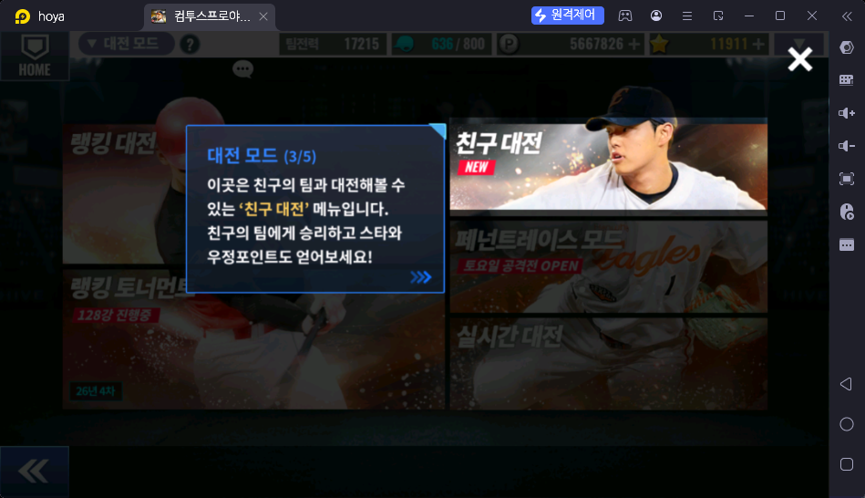
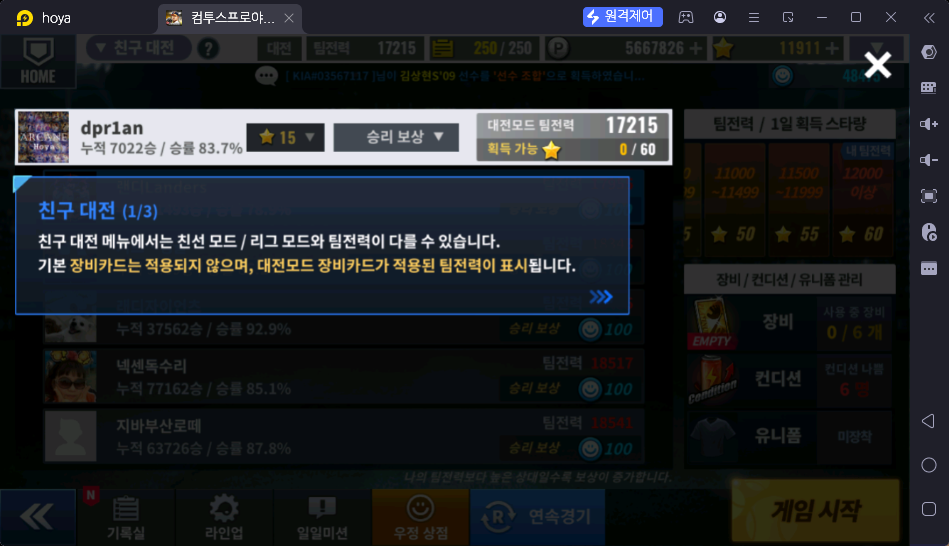
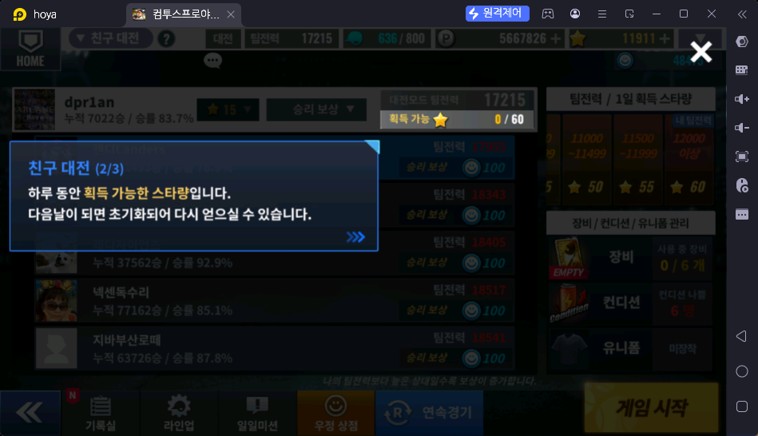
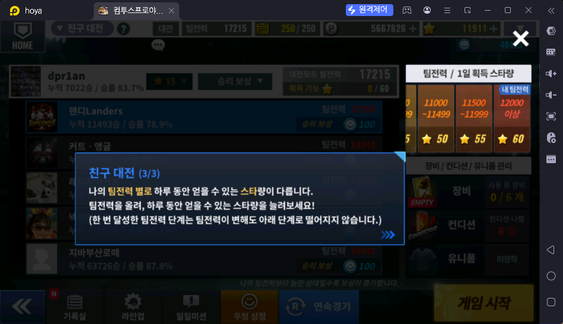
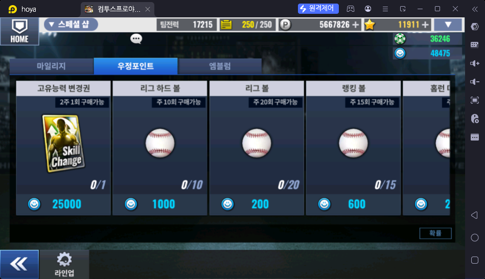
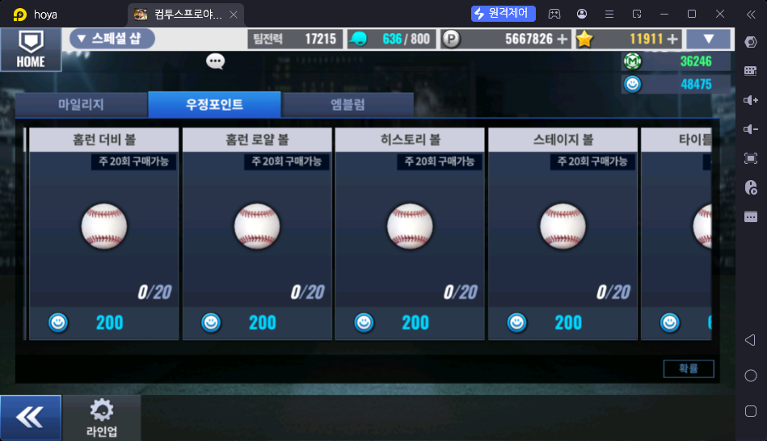
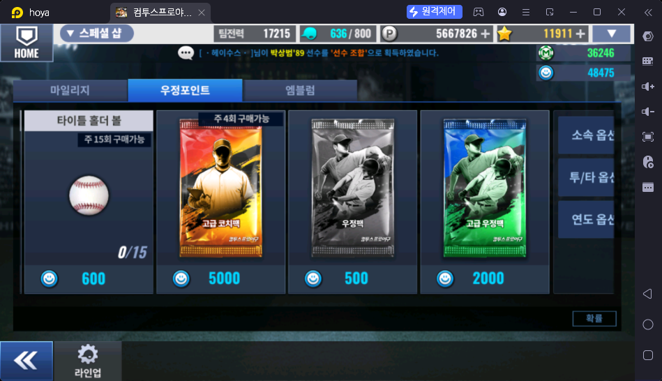

# 친구 대전 (대전 → 친구 대전)

> 출처: 게임 안 안내 1~3/3 · 우정 상점 스샷 3장 · 운영자 설명 (2026-10-17)

## 한 줄 요약

친구의 팀과 겨루는 대전. **매일 스타(★)를 최대 60개까지 받는 수급처**이고, 스타를 다 받은 뒤에는 우정포인트를 모은다. 행동력은 쓰지 않는다.

## 하는 방법

- 대전 → 친구 대전 → 상대 친구 선택 → 게임 시작 (연속경기 가능)
- 친선 모드·리그 모드와 **팀전력이 다르게 잡힌다.** 기본 장비카드는 적용되지 않고, **대전모드 장비카드가 적용된 팀전력**이 표시된다 (예: 대전모드 팀전력 17215)
- 화면 메뉴: 기록실 · 라인업 · 일일미션 · 우정 상점 · 연속경기. 오른쪽에 장비(사용 중 0/6) · 컨디션 · 유니폼 관리

## 보상

### 스타 (매일 초기화)

- **스타(★) = 로비 상단 별 재화와 같은 것**
- 하루에 받을 수 있는 스타 상한은 **내 팀전력 단계**로 정해진다 (화면 "획득 가능 ★ 0/60"). 다음 날 초기화
- **한 번 달성한 단계는 팀전력이 내려가도 아래 단계로 떨어지지 않는다**

| 팀전력 | 1일 획득 스타 |
|---|---|
| 8000 미만 | 20 |
| 8000 ~ 8999 | 25 |
| 9000 ~ 9499 | 30 |
| 9500 ~ 9999 | 35 |
| 10000 ~ 10499 | 40 |
| 10500 ~ 10999 | 45 |
| 11000 ~ 11499 | 50 |
| 11500 ~ 11999 | 55 |
| 12000 이상 | 60 |

- 한 판 이기면 받는 스타는 **상대 팀전력에 따라** 다르다. 하루 합계는 위 상한을 넘지 않는다

| 이긴 상대 | 1승당 스타 |
|---|---|
| 나보다 현저히 낮음 | 5 |
| 비슷하거나 조금 낮음 | 10 |
| 비슷함 | 15 |
| 나보다 조금 높음 | 20 |
| 나보다 많이 높음 | 25 |

### 우정포인트

- 스타 상한을 채운 뒤에는 **아직 이기지 않은 친구에게 이길 때마다 우정포인트 100.** 친구는 최대 70명 🟨
- **같은 친구에게 5번 연속 져도 우정포인트 100을 받는다**

## 보상 활용처 — 우정 상점 (스페셜 샵 → 우정포인트 탭)

- 스페셜 샵의 탭은 **마일리지 · 우정포인트 · 엠블럼** 3개. 오른쪽 위에 마일리지(M)와 우정포인트 보유량이 보인다
- 화면 오른쪽 아래 "확률" 버튼 — 팩 확률 공시. 사이트 확률 공시(`/probability`)와 내부 링크 후보

| 상품 | 가격 (우정포인트) | 구매 제한 | 운영자 평가 |
|---|---|---|---|
| 고유능력 변경권 (Skill Change, 스변권) | 25,000 | 2주 1회 | **추천** |
| 고급 코치팩 | 5,000 | 주 4회 | **추천** |
| 리그 하드 볼 | 1,000 | 주 10회 | 선택 |
| 리그 볼 | 200 | 주 20회 | 선택 |
| 랭킹 볼 | 600 | 주 15회 | 선택 |
| 홈런 더비 볼 | 200 | 주 20회 | 선택 |
| 홈런 로얄 볼 | 200 | 주 20회 | 선택 |
| 히스토리 볼 | 200 | 주 20회 | 선택 |
| 스테이지 볼 | 200 | 주 20회 | 선택 |
| 타이틀 홀더 볼 | 600 | 주 15회 | 선택 |
| 우정팩 | 500 | ❓ | 비추천 |
| 고급 우정팩 | 2,000 | ❓ | 비추천 |

## 운영자 평가 · 초보 팁

- 매일 스타 상한(최대 60)까지 챙긴다
- 우정 상점에서는 주로 **고유능력 변경권**이나 **고급 코치팩**을 산다. 볼을 바꾸는 이용자도 있다
- **우정팩 · 고급 우정팩은 아무도 사지 않는다** (사실상 버려진 상품)

## 스크린샷

**대전 모드 안내 3/5 — 친구 대전**

**친구 대전 안내 1/3 — 대전모드 팀전력**

**친구 대전 안내 2/3 — 하루 획득 가능 스타**

**친구 대전 안내 3/3 — 팀전력별 1일 스타**

**우정 상점 1 — 고유능력 변경권 · 볼**

**우정 상점 2 — 볼**

**우정 상점 3 — 코치팩 · 우정팩**

## 확인 필요

- ❓ "비슷함 / 조금 높음" 같은 구간을 가르는 팀전력 차이 기준은 몇인가? (예: ±500)
- ❓ 각 "볼"은 무엇인가? (해당 모드 입장권/추가 도전 횟수로 짐작 🟨)
- ❓ 우정 상점 목록 끝의 **소속 옵션 · 투/타 옵션 · 연도 옵션** 상품 (스샷에서 잘림) 가격·용도
