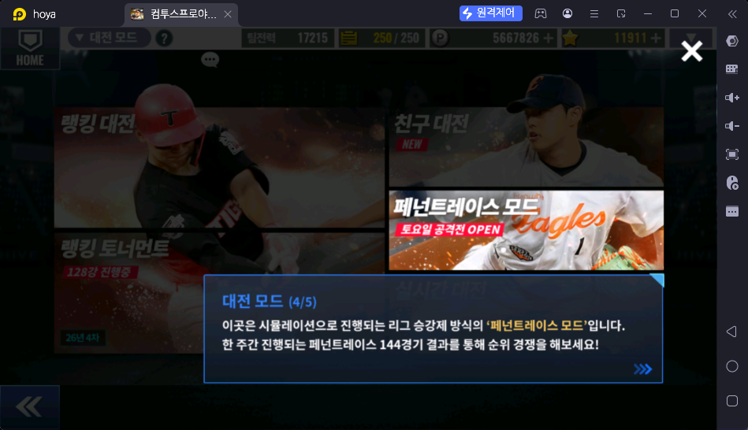

# 페넌트레이스 모드 (대전 → 페넌트레이스 모드)

> 출처: 대전 모드 안내 4/5 (2026-10-17). 아직 상세 자료 없음 — 스샷·설명을 받으면 채운다

## 한 줄 요약

시뮬레이션으로 진행하는 리그 승강제 모드. 한 주 동안 진행되는 144경기 결과로 순위를 다툰다. 토요일에 공격전이 열린다

## 하는 방법

- 대전 → 페넌트레이스 모드
- ❓ ("토요일 공격전"이 무엇인지 ❓)

## 보상

- ❓ (승강 보상 ❓)
- 주기: 주 (토요일 공격전)

## 보상 활용처

- ❓

## 운영자 평가 · 초보 팁

- ❓

## 스크린샷

**대전 모드 안내 4/5 — 페넌트레이스 모드**

## 확인 필요

- ❓ 보상 종류·수량, 입장 횟수(볼·행동력), 초보 우선도
