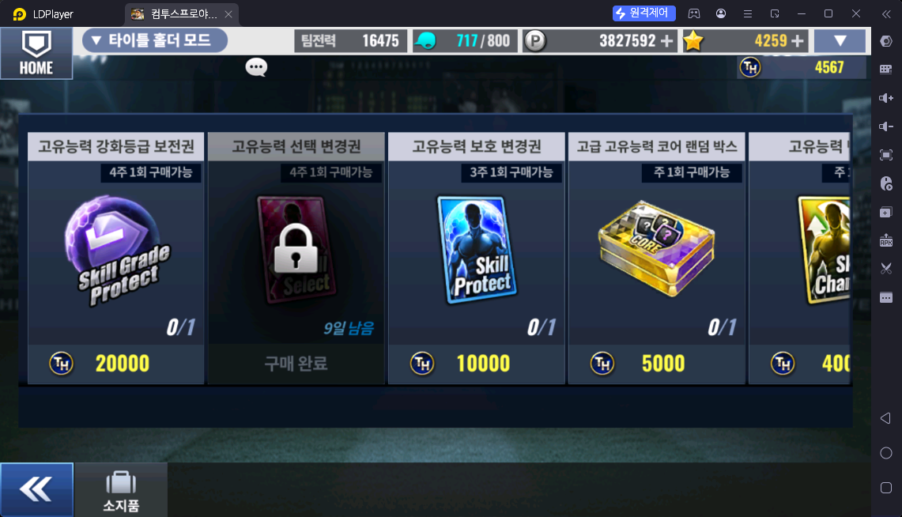
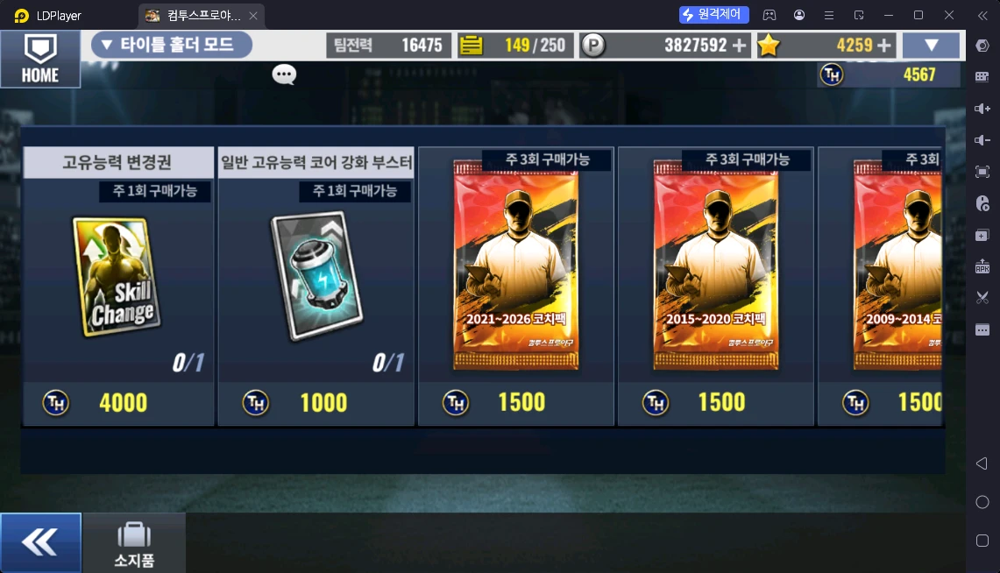
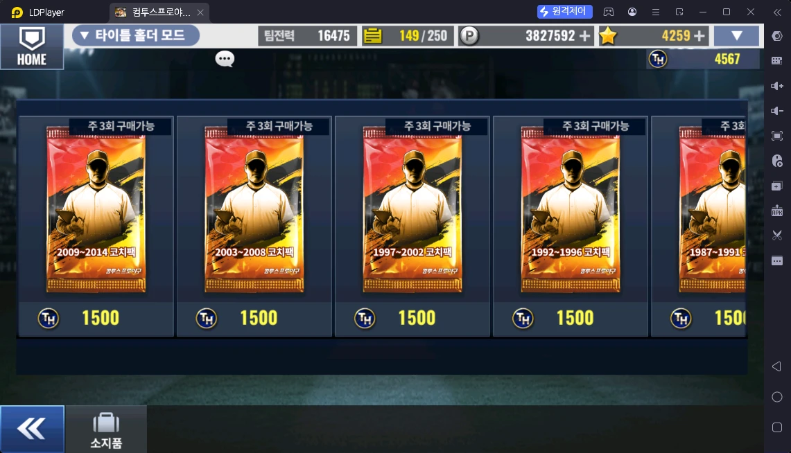
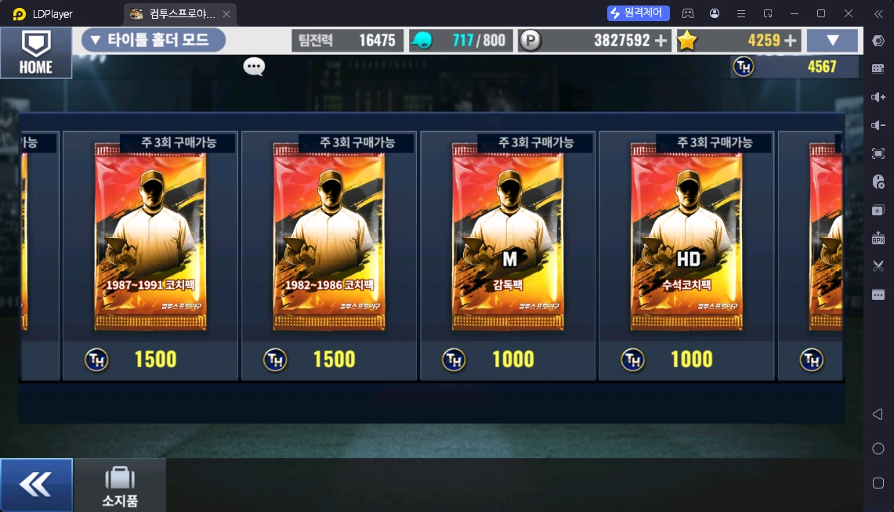
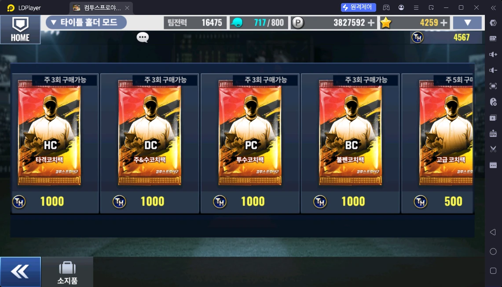

# TH 상점 (타이틀 홀더 모드 → TH 상점)

> 출처: TH 상점 스샷 5장 · 운영자 설명 (2026-10-17)

## 한 줄 요약

TH 코인으로 사는 상점. **주로 "고유능력 선택 변경권"을 사는 곳**이고, 코치 해금이 필요한 이용자는 연도 구간 코치팩도 산다.

## TH 코인 얻는 곳

| 콘텐츠 | 언제 | 수량 | 파일 |
|---|---|---|---|
| 타이틀 홀더 모드 | 경기마다 (평가 등급에 따라) | 자동 5 ~ 50 · 직접 5 ~ 110+ | [타이틀홀더모드.md](../스페셜/타이틀홀더모드.md) |
| 타이틀 홀더 모드 | 회차 끝 타이틀 시상 | 타이틀당 100 (선택 유형 2배), 6관왕 최대 900 | 〃 |
| 타이틀 홀더 모드 | 주간 랭킹 (일요일 시즌 종료) | 100 ~ 1,600+ | 〃 |

## 상품

| 상품 | 가격 (TH 코인) | 구매 제한 | 운영자 평가 |
|---|---|---|---|
| 고유능력 강화등급 보전권 (Skill Grade Protect) | 20,000 | 4주 1회 | ❓ |
| **고유능력 선택 변경권 (Skill Select)** | 15,000 | 4주 1회 | **핵심 — 이 상점의 주 목적** |
| 고유능력 보호 변경권 (Skill Protect) | 10,000 | 3주 1회 | ❓ |
| 고급 고유능력 코어 랜덤 박스 | 5,000 | 주 1회 | ❓ |
| 고유능력 변경권 (Skill Change) | 4,000 | 주 1회 | ❓ |
| 일반 고유능력 코어 강화 부스터 | 1,000 | 주 1회 | ❓ |
| 연도 구간 코치팩 8종 — 2021~2026 · 2015~2020 · 2009~2014 · 2003~2008 · 1997~2002 · 1992~1996 · 1987~1991 · 1982~1986 | 각 1,500 | 각 주 3회 | **코치 해금이 필요한 이용자** |
| 감독팩 (M) · 수석코치팩 (HD) · 타격코치팩 (HC) · 주&수코치팩 (DC) · 투수코치팩 (PC) · 불펜코치팩 (BC) | 각 1,000 | 각 주 3회 | ❓ |
| 고급 코치팩 | 500 | 주 5회 | ❓ |

## 운영자 평가 · 초보 팁

- **고유능력 선택 변경권**이 이 상점의 주 목적 (4주에 1번 살 수 있다)
- **코치 해금** = 덱을 짤 때 **같은 연도 선수 + 코치 6명**을 맞추는 것. 해금을 위해 해당 연도 구간 코치팩을 사기도 한다
- 마스터 코치 3단계 해금(마코3)을 마친 이용자는 코치팩이 덜 필요하다 🟨 (홈런 상점·스테이지 모드 설명과 연결)

## 스크린샷

**TH 상점 1 — 고유능력 보전권 · 선택 변경권 · 보호 변경권 · 코어 박스**

**TH 상점 2 — 고유능력 변경권 · 코어 강화 부스터 · 연도 코치팩**

**TH 상점 3 — 연도 코치팩**

**TH 상점 4 — 연도 코치팩 · 감독팩 · 수석코치팩**

**TH 상점 5 — 포지션 코치팩 · 고급 코치팩**

## 확인 필요

- ❓ 나머지 상품 평가 (추천 / 선택 / 비추천)
- ❓ 목록 오른쪽 끝(고급 코치팩 다음)에 상품이 더 있나
