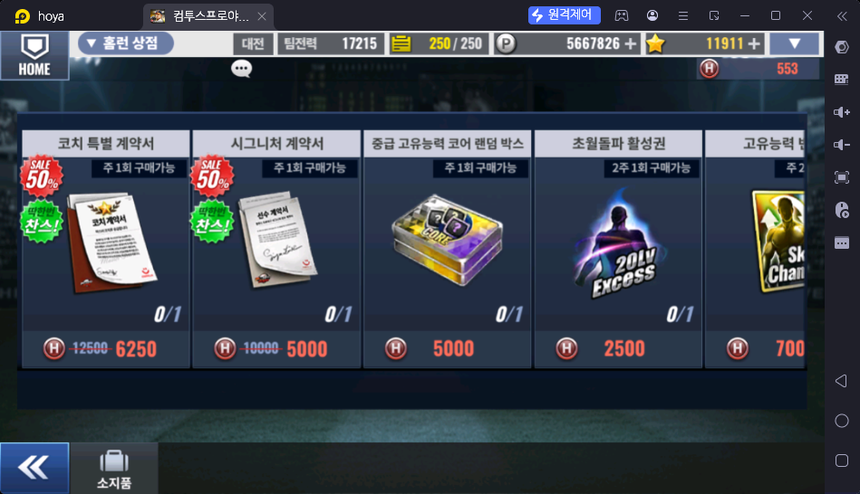
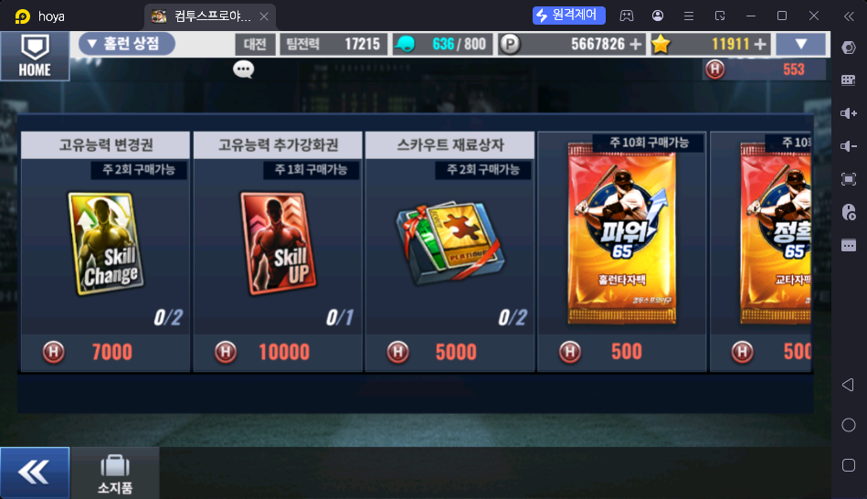
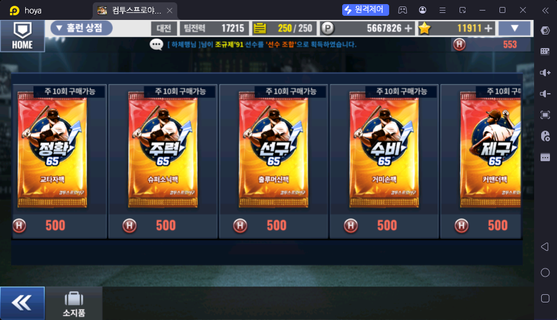
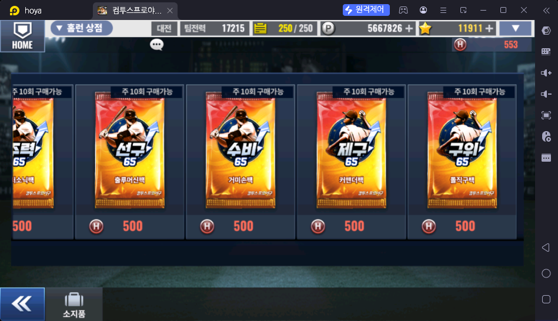

# 홈런 상점 (홈런 더비 / 홈런 로얄 → 홈런 상점)

> 출처: 홈런 상점 스샷 4장 · 운영자 설명 (2026-10-17)
> **공용 파일** — 홈런 더비와 홈런 로얄이 같은 상점·같은 재화(홈런 코인)를 쓴다. 두 콘텐츠 파일은 이 파일을 링크만 하고 상품표를 다시 적지 않는다

## 한 줄 요약

홈런 코인(H)으로 성장 아이템을 사는 상점. **코치 특별 계약서 · 시그니처 계약서 · 초월돌파 활성권을 사는 주 수급처**다.

## 홈런 코인 얻는 곳

| 콘텐츠 | 언제 | 수량 | 파일 |
|---|---|---|---|
| 홈런 더비 | 주간 리그가 끝난 뒤 등급별 | 200 ~ 1,200 (NORMAL III ~ SPECIAL I) | [홈런더비.md](../스페셜/홈런더비.md) |
| 홈런 로얄 | **한 경기마다** | ⏸ 나중에 작성 | [홈런로얄.md](../스페셜/홈런로얄.md) |

## 상품

| 상품 | 가격 (홈런 코인) | 구매 제한 | 운영자 평가 |
|---|---|---|---|
| 코치 특별 계약서 | 6,250 (정가 12,500, 50% 할인 — **계정당 1회** "딱 한 번 찬스") | 주 1회 | **뉴비 추천** |
| 시그니처 계약서 | 5,000 (정가 10,000, 50% 할인 — **계정당 1회**) | 주 1회 | **뉴비 추천** |
| 초월돌파 활성권 (20Lv Excess) | 2,500 | 2주 1회 | **뉴비 추천** |
| 중급 고유능력 코어 랜덤 박스 | 5,000 | 주 1회 | 고급 유저 |
| 고유능력 변경권 (Skill Change, 스변권) | 7,000 | 주 2회 | **비추천** — 홈런 코인 수급량이 적어서 여기 쓰기엔 아깝다 (스변권은 우정 상점에서) |
| 고유능력 추가강화권 (Skill UP) | 10,000 | 주 1회 | 고급 유저 |
| 스카우트 재료상자 | 5,000 | 주 2회 | 고급 유저 |
| 홈런타자팩 (파워 65) · 교타자팩 (정확 65) · 슈퍼소닉팩 (주력 65) · 출루머신팩 (선구 65) · 거미손팩 (수비 65) · 커맨더팩 (제구 65) · 돌직구팩 (구위 65) | 각 500 | 각 주 10회 | 비추천 |

## 운영자 평가 · 초보 팁

- **뉴비:** 홈런 상점에서 코치 특별 계약서 · 시그니처 계약서 · 초월돌파 활성권 위주로 산다
- **마코3(마스터 코치 3단계) 해금 유저, 또는 시그니처가 더 필요 없는 팀전력 15,000~16,000+ 유저:** 스카우트 재료상자 · 고유능력 추가강화권 · 고유능력 코어를 사기도 한다
- 능력치 65 팩 7종은 아무도 사지 않는다
- 덱 성장 단계 기준 후보: **팀전력 15,000~16,000+** = 시그니처가 더 필요 없는 단계 → `content-map.md` § 3 반영 후보

## 스크린샷

**홈런 상점 1 — 계약서 · 코어 · 초월돌파**

**홈런 상점 2 — 고유능력 · 스카우트 · 65팩**

**홈런 상점 3 — 65팩**

**홈런 상점 4 — 65팩**

## 확인 필요

- ⏸ 코치 특별 계약서 · 시그니처 계약서 · 초월돌파 활성권의 용도 — **지금은 작성 보류** (운영자 지시, 2026-10-17)
