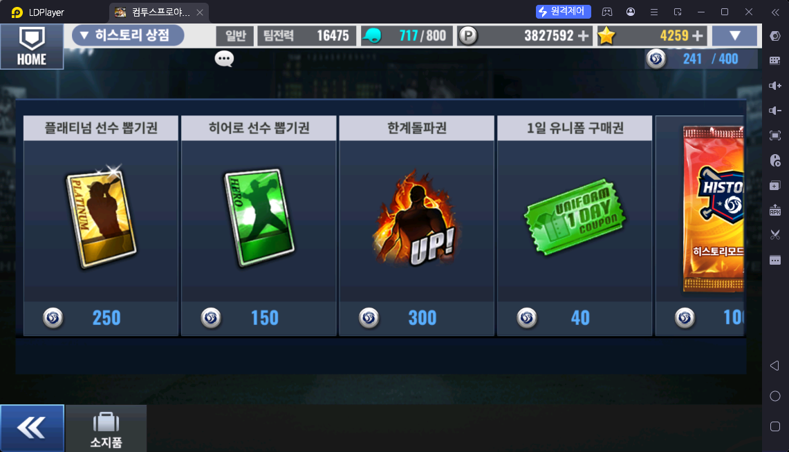
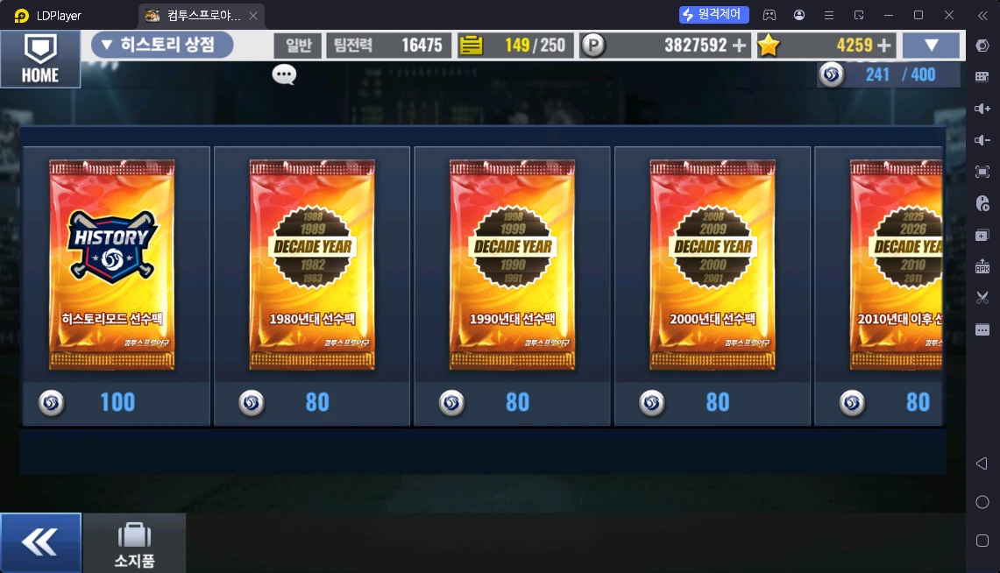

# 히스토리 상점 (히스토리 모드 → 히스토리 상점)

> 출처: 히스토리 상점 스샷 2장 · 운영자 설명 (2026-10-17)

## 한 줄 요약

히스토리 포인트로 사는 상점. **플래티넘 선수 뽑기권**(원하는 팀 로스터 저격)과 **한계돌파권**을 사는 곳이다.

## 히스토리 포인트 얻는 곳

| 콘텐츠 | 언제 | 수량 | 파일 |
|---|---|---|---|
| 히스토리 모드 | 경기마다 (팀 순서별 기본 1 / 1 / 2 / 3 / 3) | 5팀 한 바퀴 10 | [히스토리모드.md](../스페셜/히스토리모드.md) |
| 히스토리 모드 | 매일 00시 초기화 뒤 팀마다 2판 추가 보너스 (3 / 3 / 2 / 2 / 2) | 하루 볼 20개 기준 총 44 | 〃 |

- **최대 보유 400** — 넘게 받을 수 없다

## 상품

| 상품 | 가격 (히스토리 포인트) | 운영자 평가 |
|---|---|---|
| 플래티넘 선수 뽑기권 | 250 | **추천** — 덱 빌딩 중인 초보 · 레전드 재료 줍기 |
| 히어로 선수 뽑기권 | 150 | 비추천 |
| 한계돌파권 | 300 | **추천** — 덱은 다 짰는데 선수 강화가 부족한 이용자 |
| 1일 유니폼 구매권 | 40 | 비추천 |
| 히스토리모드 선수팩 | 100 | 비추천 |
| 1980년대 · 1990년대 · 2000년대 · 2010년대 이후 선수팩 | 각 80 | 비추천 |

- 뽑기권은 종류별 **최대 3장 보유**. 구매 제한(주 n회) 표시는 스샷에 없다 ❓

## 운영자 평가 · 초보 팁

- **초보(덱 빌딩 중): 플래티넘 선수 뽑기권**
- **덱 빌딩은 끝났지만 강화가 부족: 한계돌파권**
- 필요에 따라 **레전드 재료 선수 카드를 줍기 위해** 플래티넘 선수 뽑기권
- 선수팩·히어로 뽑기권·유니폼 구매권은 사지 않는다
- 💡 **4장 저격:** 플래티넘 뽑기권 3장 + 포인트 400 (→ 1장 더) 을 모아 두면 원하는 일차·연도 로스터에서 한 번에 4장

## 스크린샷

**히스토리 상점 1 — 뽑기권 · 한계돌파권 · 유니폼 구매권**

**히스토리 상점 2 — 선수팩**

## 확인 필요

- ❓ 상품별 구매 제한이 있나
