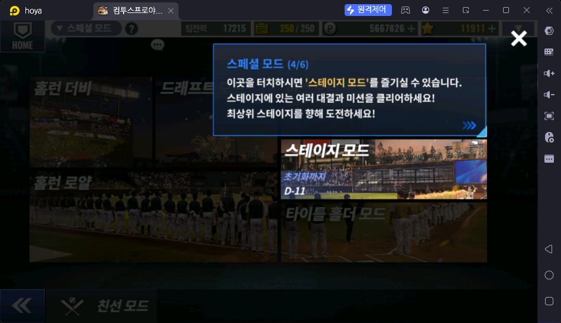
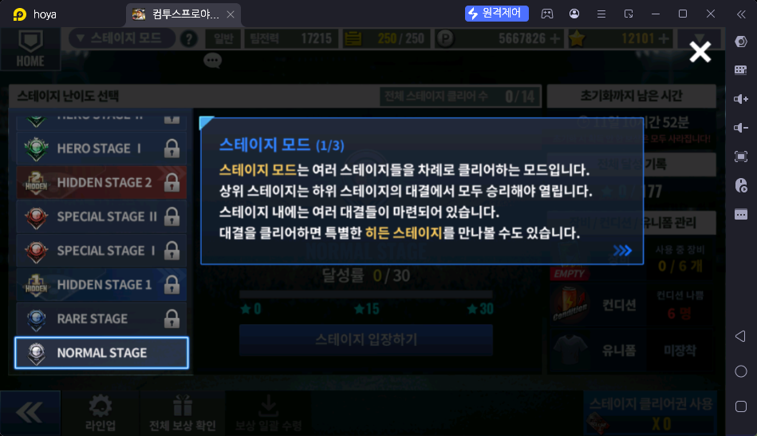
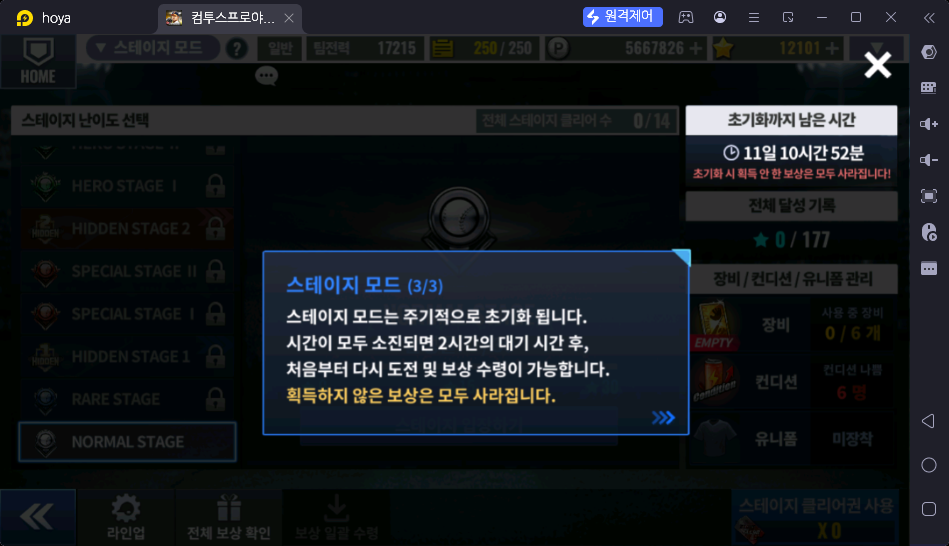
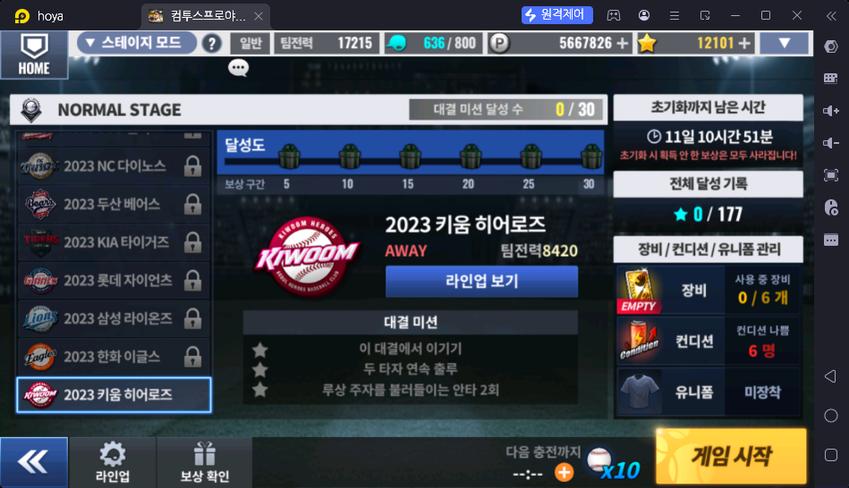
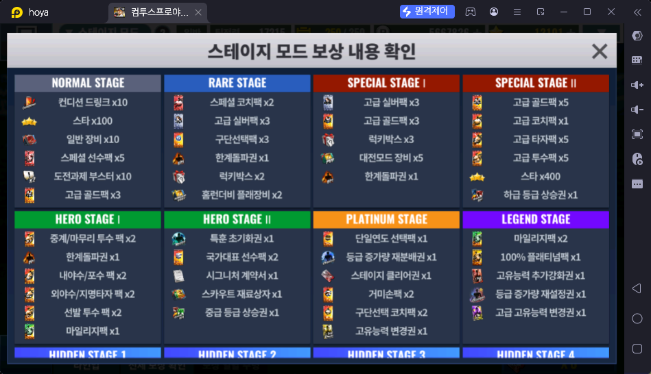
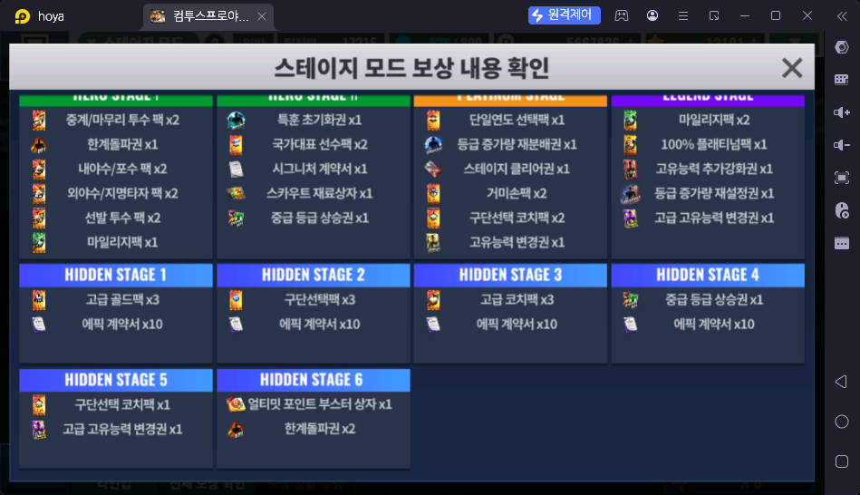
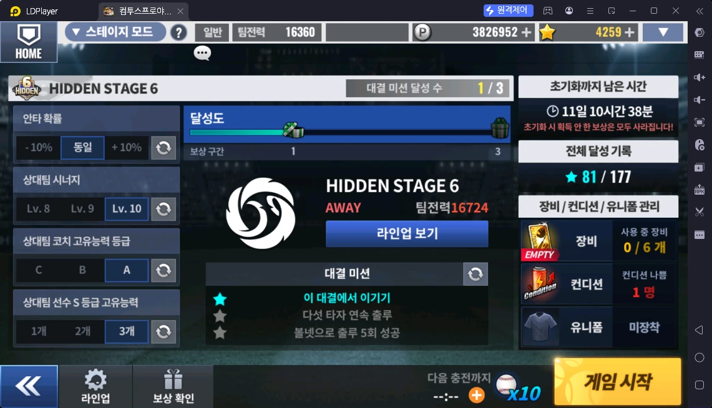

# 스테이지 모드 (스페셜 → 스테이지 모드)

> 출처: 게임 안 안내 1·3/3 · 스테이지 화면 · 보상 내용 확인 스샷 2장 · 운영자 설명 (2026-10-17)

## 한 줄 요약

여러 스테이지를 아래에서부터 차례로 깨는 모드. 스테이지마다 실제 구단(예: 2023 시즌 10개 구단)과의 대결이 있고, 대결마다 미션 3개가 걸려 있다. **스테이지마다 클리어 보상이 따로 있고**, 주기적으로 초기화되어 다시 받을 수 있다.

## 하는 방법

- 스페셜 → 스테이지 모드 → 왼쪽 **스테이지 난이도 선택** → 스테이지 입장하기 → 상대 구단 선택 → 게임 시작
- **상위 스테이지는 하위 스테이지의 대결에서 모두 이겨야 열린다**
- 대결을 클리어하면 특별한 **히든 스테이지**가 열리기도 한다
- 스테이지 순서 (아래 → 위, 스샷 기준): NORMAL(10) → RARE(7) → HIDDEN 1 → SPECIAL I(5) → SPECIAL II(7) → HIDDEN 2 → HERO I(7) → HERO II(5) → … PLATINUM(7) · LEGEND(5) · HIDDEN 3~6 위치 ❓ (괄호 = 대결 수)
- **전체 스테이지 14개** (일반 8 + 히든 6, 화면 "전체 스테이지 클리어 수 0/14"), **전체 별 177개** ("전체 달성 기록 ★ 0/177")
- 하단 메뉴: 라인업 · 전체 보상 확인 · 보상 일괄 수령 · **스테이지 클리어권 사용** (스샷 x0). 볼 충전 x10 표시 있음
- 용어: 게임 화면의 "스테이지" = 난이도 단계(NORMAL 등 14개), 그 안의 상대 구단 하나 = "대결" (일반 53개)

### 스테이지 안 구성 (NORMAL STAGE 예시)

- 상대: 2023 시즌 10개 구단 (예: 2023 키움 히어로즈 AWAY, 팀전력 8420). "라인업 보기"로 상대 라인업 확인
- **대결 미션 3개** — 하나 달성할 때마다 별 1개 (스샷 예시)
  - 이 대결에서 이기기
  - 두 타자 연속 출루
  - 루상 주자를 불러들이는 안타 2회
- 스테이지 달성도: 대결 미션 **0 / 30** (10대결 × 3). **5 · 10 · 15 · 20 · 25 · 30** 구간마다 선물상자 보상 (§ 보상)
- 스테이지 화면의 별 표시: ★0 / ★15 / ★30

### 초기화

- **한 달에 1번 초기화**된다 (운영자 설명. 스샷 당시 "11일 10시간 52분" 남음)
- 시간이 다 되면 **2시간 대기** 후 처음부터 다시 도전하고 보상을 다시 받을 수 있다
- ⚠️ **초기화 때 받지 않은 보상은 모두 사라진다** — "보상 일괄 수령"으로 꼭 받아 둔다

## 보상 (전체 보상 확인 → 스테이지 모드 보상 내용 확인)

- 보상은 스테이지(난이도 단계)마다 **대결 미션 달성 수(별)가 구간을 넘을 때마다** 하나씩 받는다 (화면 "달성도 · 보상 구간", 운영자 설명 2026-10-17)
- 마지막 구간 = 그 스테이지의 대결 수 × 3 (모든 미션 달성)
- 보상 화면의 아이템 나열 순서 = 구간 순서 (운영자 확인, 2026-10-17)

### 일반 스테이지 — 구간별 보상

| 스테이지 (대결 수) | 달성 미션 수 → 보상 |
|---|---|
| NORMAL STAGE (10) | **5** 컨디션 드링크 x10 · **10** 스타 x100 · **15** 일반 장비 x10 · **20** 스페셜 선수팩 x5 · **25** 도전과제 부스터 x10 · **30** 고급 골드팩 x3 |
| RARE STAGE (7) | **4** 스페셜 코치팩 x2 · **7** 고급 실버팩 x3 · **10** 구단선택팩 x3 · **13** 한계돌파권 x1 · **17** 럭키박스 x2 · **21** 홈런더비 플래장비 x2 |
| SPECIAL STAGE I (5) | **3** 고급 실버팩 x3 · **5** 고급 골드팩 x3 · **9** 럭키박스 x3 · **12** 대전모드 장비 x5 · **15** 한계돌파권 x1 |
| SPECIAL STAGE II (7) | **4** 고급 골드팩 x5 · **7** 고급 코치팩 x1 · **10** 고급 타자팩 x5 · **13** 고급 투수팩 x5 · **17** 스타 x400 · **21** 하급 등급 상승권 x1 |
| HERO STAGE I (7) | **4** 중계/마무리 투수 팩 x2 · **7** 한계돌파권 x1 · **10** 내야수/포수 팩 x2 · **13** 외야수/지명타자 팩 x2 · **17** 선발 투수 팩 x2 · **21** 마일리지팩 x1 |
| HERO STAGE II (5) | **3** 특훈 초기화권 x1 · **5** 국가대표 선수팩 x2 · **9** 시그니처 계약서 x1 · **12** 스카우트 재료상자 x1 · **15** 중급 등급 상승권 x1 |
| PLATINUM STAGE (7) | **4** 단일연도 선택팩 x1 · **7** 등급 증가량 재분배권 x1 · **10** 스테이지 클리어권 x1 · **13** 거미손팩 x2 · **17** 구단선택 코치팩 x2 · **21** 고유능력 변경권 x1 |
| LEGEND STAGE (5) | **3** 마일리지팩 x2 · **5** 100% 플래티넘팩 x1 · **9** 고유능력 추가강화권 x1 · **12** 등급 증가량 재설정권 x1 · **15** 고급 고유능력 변경권 x1 |

보기 쉽게 구간만 따로:

| 구간 유형 | 스테이지 |
|---|---|
| 5 / 10 / 15 / 20 / 25 / 30 | NORMAL |
| 4 / 7 / 10 / 13 / 17 / 21 | RARE · SPECIAL II · HERO I · PLATINUM |
| 3 / 5 / 9 / 12 / 15 | SPECIAL I · HERO II · LEGEND |
| 1 / 3 | 모든 히든 스테이지 |

### 히든 스테이지 — 구간 1 (승리) · 3 (모든 미션)

- 미션 1이 "이 대결에서 이기기" 라서 **이기기만 하면 구간 1 보상**, 미션 3개를 다 깨면 구간 3 보상

| 히든 스테이지 | 1 (승리) | 3 (모든 미션) |
|---|---|---|
| HIDDEN STAGE 1 | 고급 골드팩 x3 | 에픽 계약서 x10 |
| HIDDEN STAGE 2 | 구단선택팩 x3 | 에픽 계약서 x10 |
| HIDDEN STAGE 3 | 고급 코치팩 x3 | 에픽 계약서 x10 |
| HIDDEN STAGE 4 | 중급 등급 상승권 x1 | 에픽 계약서 x10 |
| HIDDEN STAGE 5 | 구단선택 코치팩 x1 | 고급 고유능력 변경권 x1 |
| HIDDEN STAGE 6 | 얼티밋 포인트 부스터 상자 x1 | 한계돌파권 x2 |

- 예: **HIDDEN 6** 은 승리만 해도 얼티밋 포인트 부스터 상자 x1, 모든 미션을 깨면 한계돌파권 x2 (운영자 확인)

## 대결 미션 전체 목록 (출처: 운영자 정리, 2026-10-17)

- **일반 스테이지 8단계, 대결 53개, 미션 159개.** 모든 대결의 미션 1은 **"이 대결에서 이기기"** 로 같아서 표에는 미션 2·3만 적는다
- 미션 하나 = 별 1개. 일반 159개 + 히든 6스테이지 × 3 = 18개 → **전체 별 177개** (화면 "전체 달성 기록 ★ 0/177" 과 일치)
- "(전체 플레이)" 가 붙은 미션은 자동 진행 없이 경기 전체를 직접 해야 한다 🟨

### NORMAL STAGE — 10개 대결

| 상대 | 미션 2 | 미션 3 |
|---|---|---|
| 2023 LG 트윈스 | 한 이닝 3득점 이상 | 3구 삼진 2회 |
| 2023 kt 위즈 | 루상 주자를 불러들이는 안타 1회 | 두 타자 연속 삼진 |
| 2023 SSG 랜더스 | 홈런 1회 성공 | 구원 투수 1회 활용 |
| 2023 NC 다이노스 | 2루타 1회 성공 | 수비 위치 변경 2회 |
| 2023 두산 베어스 | 루상 주자를 불러들이는 안타 1회 | 3구 삼진 1회 |
| 2023 KIA 타이거즈 | 두 타자 연속 출루 | 홈런 2회 성공 |
| 2023 롯데 자이언츠 | 도루 시도 3회 | 대타 자원 2회 활용 |
| 2023 삼성 라이온즈 | 번트 작전 2회 성공 | 홈런 1회 성공 |
| 2023 한화 이글스 | 초구 안타 1회 | 희생플라이 1회 |
| 2023 키움 히어로즈 | 두 타자 연속 출루 | 루상 주자를 불러들이는 안타 2회 |

### RARE STAGE — 7개 대결

| 상대 | 미션 2 | 미션 3 |
|---|---|---|
| 2013 삼성 라이온즈 | 루상 주자를 불러들이는 안타 1회 | 3구 삼진 2회 |
| 2014 키움 히어로즈 | 번트 작전 2회 성공 | 중간 계투로 4삼진 달성 |
| 2017 KIA 타이거즈 | 2루타 1회 성공 | 삼자범퇴 처리 3회 |
| 2018 SK 와이번스 | 초구 안타 1회 | 솔로 홈런 |
| 2019 두산 베어스 | 희생플라이 1회 | 8회 이후 3득점 이상 |
| 2020 NC 다이노스 | 한 이닝 3득점 이상 | 도루 시도 3회 |
| 2021 kt 위즈 | 두 타자 연속 출루 | 한 이닝 3득점 이상 |

### SPECIAL STAGE I — 5개 대결

| 상대 | 미션 2 | 미션 3 |
|---|---|---|
| 1990 LG 트윈스 | 도루 2회 성공 | 한 게임 10삼진 달성 |
| 1992 롯데 자이언츠 | 2루타 2회 성공 | 1사 후 만루에서 무실점 1회 |
| 1997 쌍방울 레이더스 | 홈런 2회 성공 | 중간 계투로 4삼진 달성 |
| 1998 현대 유니콘스 | 솔로 홈런 2회 | 2사 후 만루에서 무실점 2회 |
| 1999 한화 이글스 | 다섯 타자 연속 출루 | 투수 4실점 이하 승리(전체 플레이) |

### SPECIAL STAGE II — 7개 대결

| 상대 | 미션 2 | 미션 3 |
|---|---|---|
| 80년대 롯데 자이언츠 | 다섯 타자 연속 출루 | 두 타자 연속 삼진 |
| 80년대 삼성 라이온즈 | 2루타 2회 성공 | 2사 후 만루에서 무실점 1회 |
| 80년대 삼미 슈퍼스타즈 | 홈런 2회 성공 | 더블 플레이 1회 |
| 80년대 MBC 청룡 | 도루 3회 성공 | 풀카운트 삼진 3회 |
| 80년대 OB 베어스 | 번트 작전 2회 성공 | 3구 삼진 5회 |
| 80년대 해태 타이거즈 | 솔로 홈런 2회 | 투수 4실점 이하 승리(전체 플레이) |
| 80년대 빙그레 이글스 | 한 이닝 3득점 이상 | 1사 후 만루에서 무실점 1회 |

### HERO STAGE I — 7개 대결

| 상대 | 미션 2 | 미션 3 |
|---|---|---|
| 2004 현대 시그니처 | 홈런 5회 성공 | 선발 투수 완투승(전체 플레이) |
| 2007 SK 시그니처 | 번트 작전 4회 성공 | 두 타자 연속 삼진 |
| 2013 LG 시그니처 | 2루타 2회 성공 | 3구 삼진 5회 |
| 2015 NC 시그니처 | 두 타자 연속 홈런 | 2사 후 만루에서 무실점 2회 |
| 2017 롯데 시그니처 | 세 타자 연속 안타 | 풀카운트 삼진 2회 |
| 2018 한화 시그니처 | 솔로 홈런 2회 | 더블 플레이 1회 |
| 2020 kt 시그니처 | 연속 타자 1타점 합작 | 한 게임 16삼진 달성 |

### HERO STAGE II — 5개 대결

| 상대 | 미션 2 | 미션 3 |
|---|---|---|
| 가을의 전설 | 세 타자 연속 안타 | 2사 후 만루에서 무실점 1회 |
| 아빠와 아들 | 2루타 2회 성공 | 풀카운트 삼진 2회 |
| 벤치클리어링 | 번트 작전 4회 성공 | 선발 투수 완봉승(전체 플레이) |
| 트레이드 사가 | 홈런 5회 성공 | 더블 플레이 1회 |
| 나때는 말이야 | 선발 전원 2안타 | 한 게임 10삼진 달성 |

### PLATINUM STAGE — 7개 대결

| 상대 | 미션 2 | 미션 3 |
|---|---|---|
| 10년대 올스타 | 홈런 5회 성공 | 두 타자 연속 삼진 |
| 00년대 올스타 | 세 타자 연속 안타 | 2사 후 만루에서 무실점 2회 |
| 90년대 올스타 | 두 타자 연속 홈런 | 더블 플레이 1회 |
| 80년대 올스타 | 2루타 2회 성공 | 풀카운트 삼진 3회 |
| 내일은 MVP | 도루 3회 성공 | 선발 투수 완투승(전체 플레이) |
| 내일은 국가대표 | 희생플라이 1회 | 한 게임 5삼진 달성 |
| 내일은 신인왕 | 2루타 5회 성공 | 3구 삼진 5회 |

### LEGEND STAGE — 5개 대결

| 상대 | 미션 2 | 미션 3 |
|---|---|---|
| KBO 레전드 40 | 다섯 타자 연속 출루 | 투수 4실점 이하 승리(전체 플레이) |
| 2010 SK 레전드 | 초구 안타 1회 | 한 게임 10삼진 달성 |
| 1999 한화 레전드 | 도루 2회 성공 | 중간계투 2이닝(6아웃) 무실점 |
| 1994 LG 레전드 | 번트 작전 4회 성공 | 3구 삼진 5회 |
| 2000 특수 카드 해금 | 도루 3회 성공 | 선발 투수 완투승(전체 플레이) |

## 히든 스테이지 — 상대 조건 · 미션 재설정

- 히든 스테이지는 대결 1개. 미션 1은 **"이 대결에서 이기기"** 고정, **미션 2·3은 재설정(새로고침)으로 무작위로 바뀐다**
- 왼쪽에 **상대 조건 4가지**가 있고, 각각 새로고침 버튼이 있다 (스샷: HIDDEN STAGE 6, 상대 팀전력 16,724)

| 상대 조건 | 선택지 (스샷 기준) |
|---|---|
| 안타 확률 | -10% · 동일 · +10% |
| 상대팀 시너지 | Lv.8 · Lv.9 · Lv.10 |
| 상대팀 코치 고유능력 등급 | C · B · A |
| 상대팀 선수 S 등급 고유능력 | 1개 · 2개 · 3개 |

- ❓ 상대 조건도 스타를 써서 새로고침하나? 조건이 쉬울수록 보상이 같은가?
- 달성도 보상 구간은 **1 · 3** 두 칸 — 1 = 승리, 3 = 모든 미션 (§ 보상)

### 미션 재설정 후보 (HIDDEN STAGE 6 화면 기준)

| 미션 2 후보 | 미션 3 후보 |
|---|---|
| 한 게임 5삼진 달성 | 2루타 5회 성공 |
| 다섯 타자 연속 출루 | 볼넷으로 출루 5회 성공 |
| 홈런 5회 성공 | 다섯 타자 연속 홈런 |
| 3구 삼진 5회 | 선발 전원 2안타 |
| 다섯 타자 연속 삼진 | 더블 플레이 5회 |

- ❓ 모든 히든 스테이지에 같은 후보가 나오는지는 확인 안 됨 (히든 6 화면 한 장 기준)

### 미션 재설정 비용 (스타)

| 히든 스테이지 | 1회 재설정 |
|---|---|
| HIDDEN 1 | 10 ★ |
| HIDDEN 2 | 20 ★ |
| HIDDEN 3 | 40 ★ |
| HIDDEN 4 | 80 ★ |
| HIDDEN 5 | 100 ★ |
| HIDDEN 6 | 120 ★ |

- 모든 히든 스테이지를 1회씩 재설정하면 **370 ★**
- 💡 공략 글 아이디어: 재설정 횟수를 고르면 필요한 스타를 계산해 주는 작은 계산기 (운영자 정리본에 있던 형태)

## 보상 활용처

- 스타 → ❓ (로비 별 재화)
- 마일리지팩 → 마일리지 (사이트 `/mileage` 내부 링크 후보)
- 그 밖의 팩·권 → ⏸ 운영자가 정리 예정

## 운영자 평가 · 초보 팁 (운영자 설명, 2026-10-17)

### 왜 하나 — 핵심 보상 두 가지

1. **고급 고유능력 변경권** — 대부분의 이용자가 스테이지 모드를 하는 이유. LEGEND STAGE 마지막 구간(15) · HIDDEN STAGE 5 모든 미션(3) 에서 나온다
2. **에픽 계약서** — 최근 업데이트로 **HIDDEN STAGE 1 ~ 4** 의 모든 미션 보상(3)이 에픽 계약서 x10 이 됐다. **이것도 꼭 깬다**

### 어디까지 깨면 되나 — 권장 목표

| 스테이지 | 목표 구간 | 그때 받는 보상 | 대상 |
|---|---|---|---|
| SPECIAL STAGE II | 17 | 스타 x400 | 경우에 따라 |
| HERO STAGE II | 12 | 스카우트 재료상자 x1 | 경우에 따라 |
| PLATINUM STAGE | 17 / 21 | 구단선택 코치팩 x2 / 고유능력 변경권(스킬 변경권) x1 | **코치 해금(마스터 코치 3단계, "마코3")을 하지 않은 이용자** 권장 |
| HIDDEN STAGE 1 ~ 4 | 3 (모든 미션) | 에픽 계약서 x10 (각각) | 모두 |
| HIDDEN STAGE 5 | 3 (모든 미션) | 고급 고유능력 변경권 x1 | 모두 |
| LEGEND STAGE | 15 (모든 미션) | 고급 고유능력 변경권 x1 | 깰 수 있는 이용자 |

- **뉴비는 한계돌파권을 모으려고 돌리기도 한다** — 한 번 초기화마다 꽤 많이 받는다

| 한계돌파권 나오는 곳 | 구간 | 수량 |
|---|---|---|
| RARE STAGE | 13 | x1 |
| SPECIAL STAGE I | 15 (모든 미션) | x1 |
| HERO STAGE I | 7 | x1 |
| HIDDEN STAGE 6 | 3 (모든 미션) | x2 |
| **합계 (초기화 1회)** | | **x5** |

- **한 달에 1번 초기화** — 매달 처음부터 다시 깨야 해서 시간이 지날수록 귀찮은 콘텐츠지만, **여기서만 나오는 재화가 많아서** 열심히 하는 이용자는 꾸준히 한다
- 초기화 전에 **보상 일괄 수령** 잊지 않기 (받지 않은 보상은 사라진다)
- ⏸ 팀전력 몇이면 어느 스테이지까지 가능한지 — 운영자 정리 예정

## 스크린샷

**스페셜 모드 안내 4/6 — 스테이지 모드**

**스테이지 모드 안내 1/3 — 스테이지 구조**

**스테이지 모드 안내 3/3 — 초기화**

**NORMAL STAGE — 대결 미션**

**스테이지 보상 내용 1**

**스테이지 보상 내용 2 (히든)**

**HIDDEN STAGE 6 — 상대 조건 · 미션 재설정**

## 확인 필요

- ⏸ 히든 스테이지가 열리는 조건, 각 아이템 용도, 뉴비가 어디까지 깰 수 있나 — 운영자 정리 예정
