# 타이틀 홀더 모드 (스페셜 → 타이틀 홀더 모드)

> 출처: 스페셜 모드 안내 5/6 · 타이틀홀더 안내 1~4/4 · 메인·경기 화면 · 주간 랭킹 보상 스샷 · 운영자 설명 (2026-10-17)

## 한 줄 요약

**내 타자 1명**을 등록해 그 타자의 타석만 직접 치는 모드. 실제 팀의 25인 로스터 중 한 명과 바꿔 들어가 **36경기 리그**를 뛰고, 타격 결과로 **TH 포인트**를 쌓아 1주일 시즌 순위를 다툰다.

## 하는 방법

- 스페셜 → 타이틀 홀더 모드 → 타자 등록(카드 왼쪽 위 교체 버튼) → **타이틀 홀더 모드 입장하기**
- **등록한 타자의 타석에서만 플레이**한다. 팀별로 정해진 25인 로스터 중 선수 한 명과 교체되어 36경기 리그에 참여한다
- **시즌 = 1주일.** **월요일 06:00 ~ 일요일 23:59** 진행. 월요일 00:00 ~ 05:59 는 이용할 수 없다
- 한 시즌 안에서 **36경기 리그를 회차로 여러 번** 돌 수 있다 (스샷: "237시즌 · 1회차 32/36 경기")
- **중도 포기** 버튼: ★ 500 (회차를 처음부터 다시 시작 🟨)
- ⚠️ 이 모드에서는 **세트덱 · 코치 증가량 · 시너지 · 장비 · 유니폼 · 금주의 선수가 적용되지 않고, 컨디션은 보통으로 고정**된다 → **타자 카드 자체의 능력치**만 중요하다
- 경기 화면: **나의 타자 / TH 포인트 랭킹** 탭 · **경기 일정**(36경기, 상대 선발 투수 표시) · **회차 목표** · **타순** · 하단 스케줄 · 기록실 · TH 상점
- **볼을 쓴다** — 경기 화면 하단 "다음 충전까지 0:43:15 · 볼 x4" (충전 간격·최대치 ❓)
- 입장 전 화면: 시즌 최고 기록(타수·타율·안타·2루타·3루타·홈런·타점·볼넷·출루율·장타율·OPS) · 이전 회차 기록 · TH 포인트 랭킹 · 나의 랭킹. 하단 메뉴: 기록실 · TH 상점

### 예시 기록 (운영자 계정 스샷)

| 회차 | 타자 | TH 포인트 | 타율 | 홈런 | 타점 | OPS | 나의 랭킹 |
|---|---|---|---|---|---|---|---|
| 1 (32/36 경기 시점) | 김동주B (정확 110 · 파워 123 · 선구 112 · 주력 109 · 수비 100, Lv 30/30) | 3,705 | 0.481 | 16 | 41 | 1.563 | SPECIAL I · 12,343위 |

- 같은 시즌 TH 포인트 랭킹 1 ~ 3위는 약 10,000 ~ 12,000점

## TH 포인트 — 어떻게 쌓이나 (운영자 설명)

- TH 포인트는 **36경기 회차마다 따로** 쌓인다. **랭킹은 가장 높은 회차의 점수**로 집계되고, 새 회차에서 이전 최고 점수를 넘으면 랭킹이 갱신된다 (경기 화면 도움말)
- 한 경기에서 얻는 보상은 두 가지 (경기 기록 화면): **TH 포인트**(순위용) + 평가 등급에 따른 **TH 코인**(상점용)
  - 예: 4타수 3안타 1홈런 1타점 → **TH 포인트 135**, 평가 **S 등급 → TH 코인 x50**, 타순 1번 → 1번 유지
  - **한 경기 TH 코인: 자동 플레이 5 ~ 50, 직접 플레이 5 ~ 110 이상** (운영자 설명) — 직접 칠수록 훨씬 많이 받는다
  - 평가 등급(E ~ S)과 코인 수량의 정확한 계산식은 알 수 없다 (운영자 확인) — 글에서는 "성적이 좋을수록 많이" 로만 쓴다
- 점수가 많이 오르는 순서: **홈런 > 타점 > 안타 > 출루.** 특히 **타점을 많이 낼수록** 점수가 높다
- **타자 평가 등급:** 처음 **E** 에서 시작해 성적이 좋으면 **S** 까지 오른다. **S 등급을 받으면 다음 경기에 1번 타순**으로 배치되어 타석이 많아진다 → 점수를 더 쌓을 수 있다

### 회차 목표 — 타이틀 홀더 시상 (회차 끝, 36경기 후)

- 36경기 회차가 끝나면 **타자 기록 6개 부문 타이틀 홀더 시상**이 열린다. 1위를 한 부문마다 **TH 코인 100**
- 경기 중에도 회차 목표에서 현재 순위가 보인다 (경기 기록 화면 하단: 타격왕 0.497(1위) · 안타왕 72개(1위) …)

| 묶음 | 타이틀 | 2배 받는 유형 |
|---|---|---|
| 위 3개 | 안타왕 · 타격왕 · 출루율왕 | **교타자** |
| 아래 3개 | 홈런왕 · 타점왕 · 장타율왕 | **장타자** |

- **타자 유형 선택 (교타자 / 장타자):** 고른 유형의 3개 타이틀을 따면 **TH 코인 2배**
- 계산 예 (운영자 회차, 교타자 선택 · 6관왕): 교타자 3개 × 200 + 장타자 3개 × 100 = **TH 코인 900** (화면 Total 900 과 일치)
- 💡 **6관왕을 노리면 회차 하나에 TH 코인 최대 900** — 유형은 내 타자에게 쉬운 쪽을 고른다 🟨

### 회차 끝 기록 화면

- 이번 회차 기록 · 시즌 최고 기록 · 역대 최고 기록(시즌 종료 후 갱신)을 보여준다
- 예 (운영자): 이번 회차 **4,405점** (타율 0.497 · 홈런 20 · 타점 51 · OPS 1.648, 시즌 최고 기록 달성) / 역대 최고 **6,511점** (226시즌, 타율 0.622 · 홈런 32 · 타점 85 · OPS 1.953)

## 보상 — 주간 랭킹 보상 (TH 코인)

- 시즌(1주)이 끝나면 **최고 회차 TH 포인트 순위**로 등급이 정해지고 **TH 코인**을 받는다
- 운영자 계정 예: 3,705점 · 12,346위 → **SPECIAL I (상위 20 ~ 29.99%)** → TH 코인 400

| 등급 | 순위 구간 | TH 코인 |
|---|---|---|
| PLATINUM IV 위 등급 | 뉴비·초보는 닿지 않아 다루지 않음 (운영자) | — |
| PLATINUM IV | 201 ~ 300위 | 1,600 |
| HERO I | 301 ~ 500위 | 1,200 |
| HERO II | 501 ~ 700위 | 1,000 |
| HERO III | 701위 ~ 상위 9.99% | 800 |
| HERO IV | 10 ~ 19.99% | 600 |
| SPECIAL I | 20 ~ 29.99% | 400 |
| SPECIAL II | 30 ~ 39.99% | 300 |
| SPECIAL III | 40 ~ 49.99% | 200 |
| RARE I | 50 ~ 59.99% | 180 |
| RARE II | 60 ~ 69.99% | 160 |
| RARE III | 70 ~ 79.99% | 140 |
| NORMAL I | 80 ~ 89.99% | 120 |
| NORMAL II | 90 ~ 100% | 100 |

- 화면 오른쪽 위 TH 코인 보유량 (스샷 3,487)

## 보상 활용처

- TH 코인 → **[TH 상점](../상점/TH상점.md)** — 주로 **고유능력 선택 변경권**을 산다
- 우정 상점에서 "타이틀 홀더 볼"을 판다 (600 우정포인트 · 주 15회 — `../대전/친구대전.md`) ❓ 볼의 쓰임

## 운영자 평가 · 초보 팁

- ⏸ 운영자 정리 예정

## 스크린샷

**스페셜 모드 안내 5/6 — 타이틀 홀더 모드**

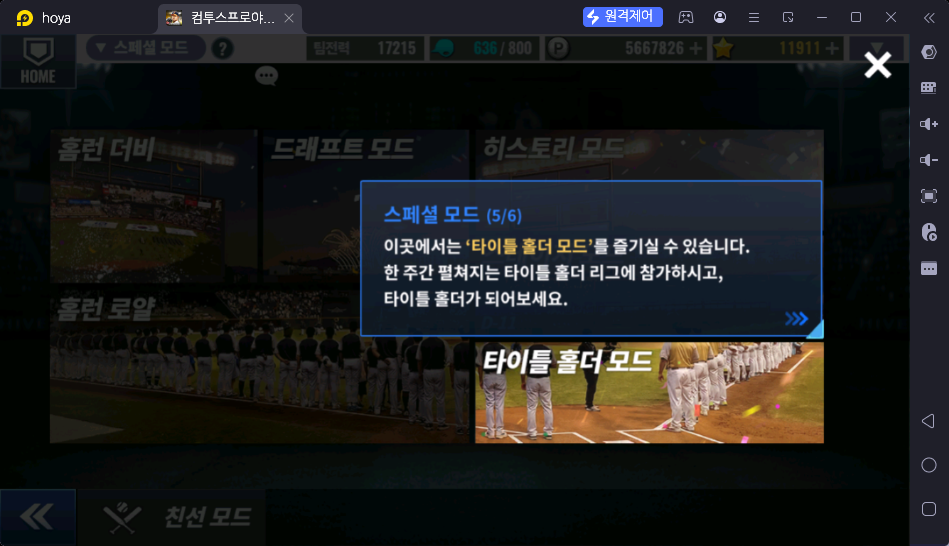

**타이틀 홀더 메인 화면**

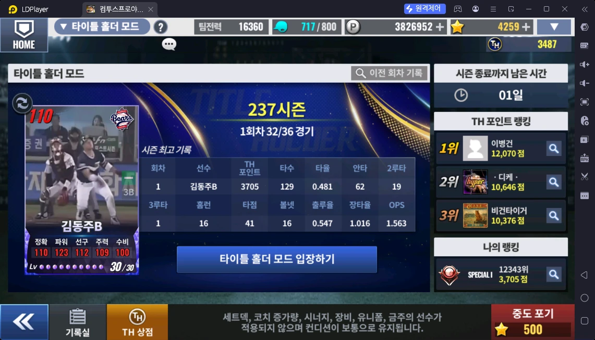

**타이틀홀더 안내 1/4 — 타자 1명 등록 · 36경기 리그**

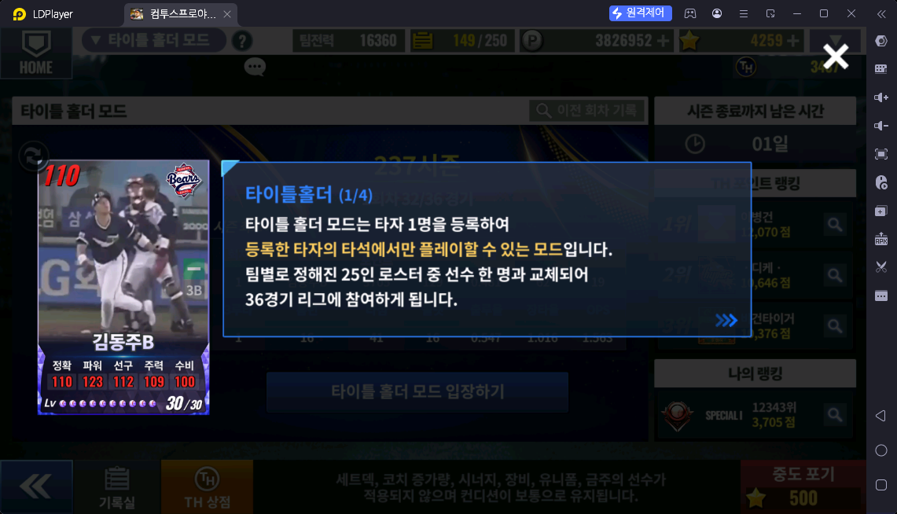

**타이틀홀더 안내 2/4 — 1주일 시즌제**

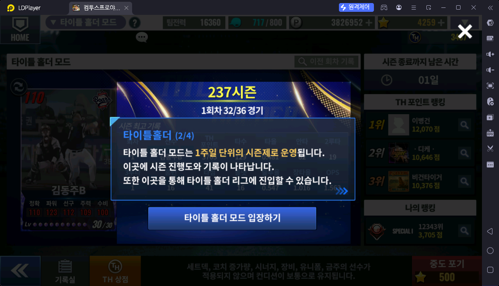

**타이틀홀더 안내 3/4 — 진행 기간**

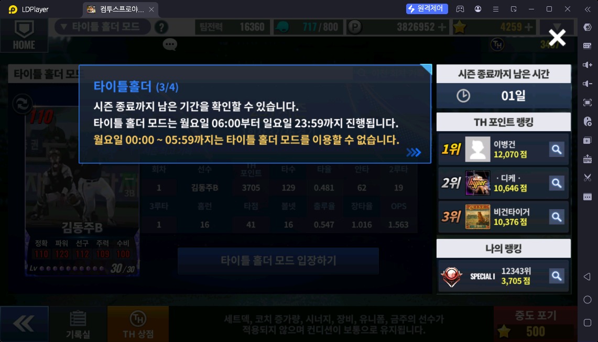

**타이틀홀더 안내 4/4 — TH 포인트 · 순위 집계**

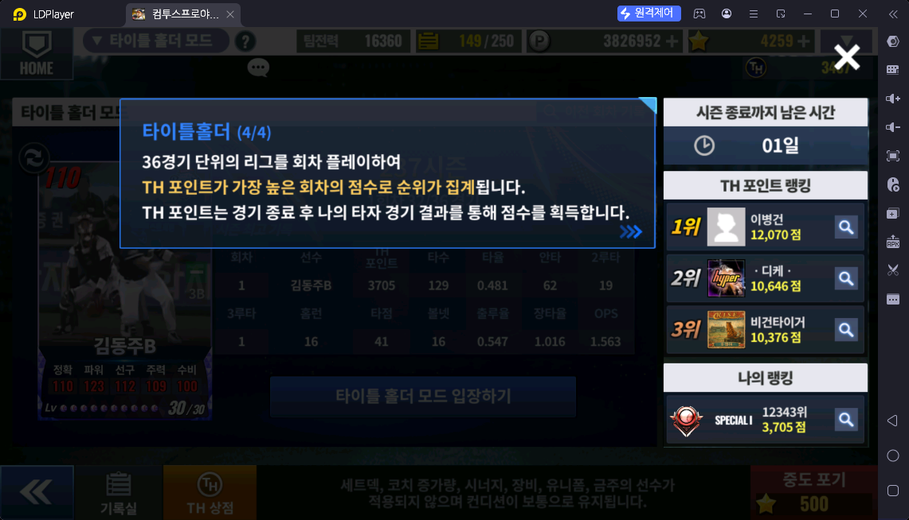

**경기 화면 — 경기 일정 · 회차 목표 · 타순 · TH 포인트 도움말**

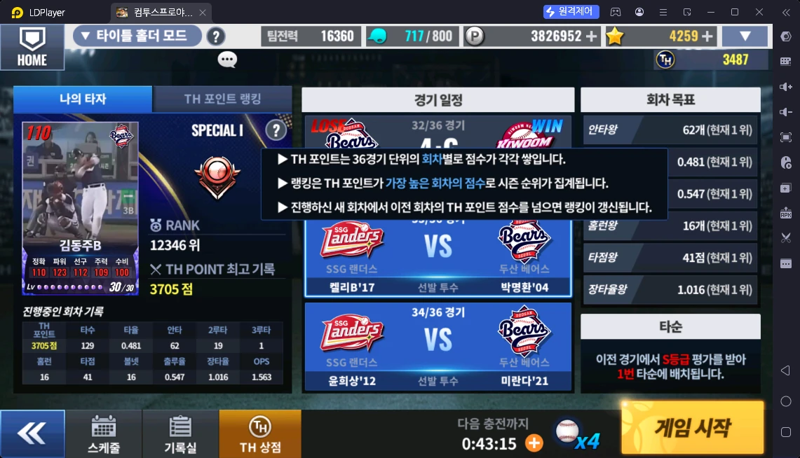

**회차 목표 — 위 3개 / 아래 3개**

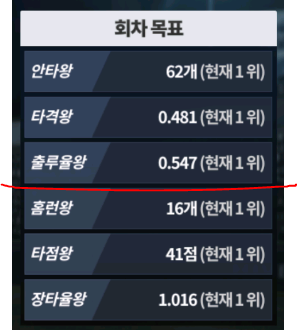

**경기 기록 — TH 포인트 · 평가 등급 · TH 코인 · 타순 조정**

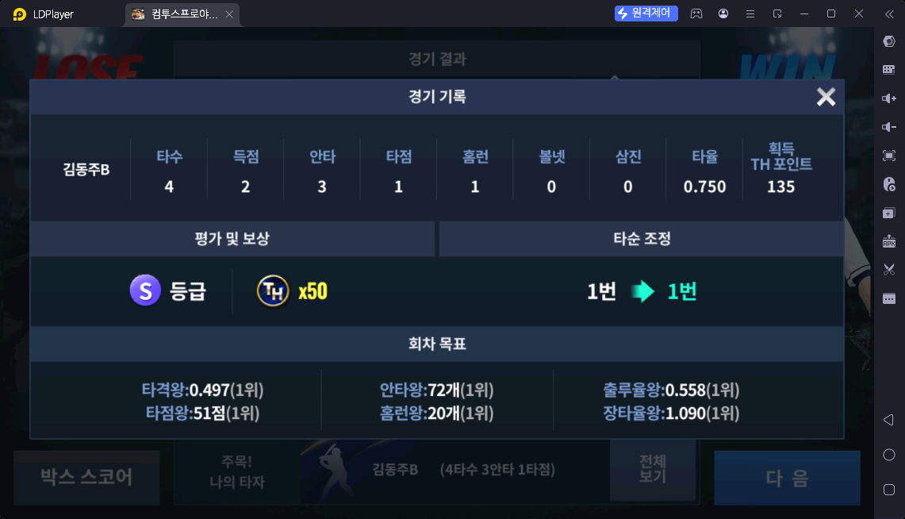

**타이틀 홀더 시상 안내**

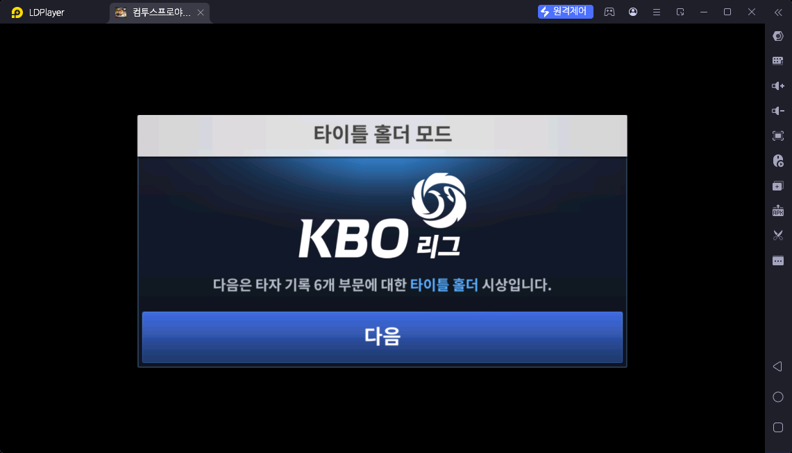

**타이틀 홀더 수상 보너스 — 6관왕 TH 코인 900**

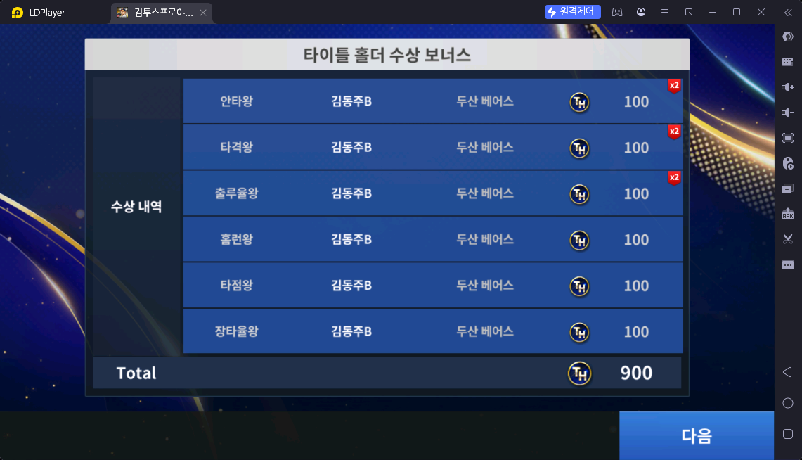

**회차 기록 · 시즌 최고 · 역대 최고**

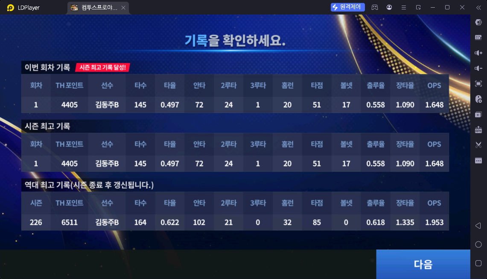

**타자 유형 선택 — 교타자 / 장타자**

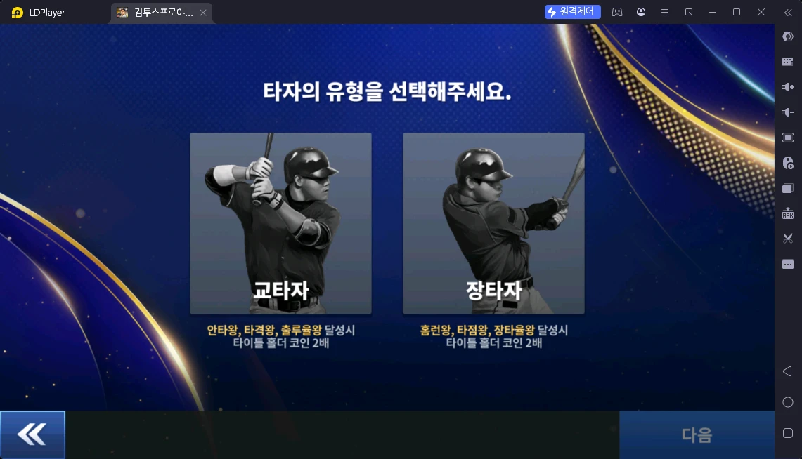

**주간 랭킹 보상 1 (SPECIAL ~ NORMAL)**

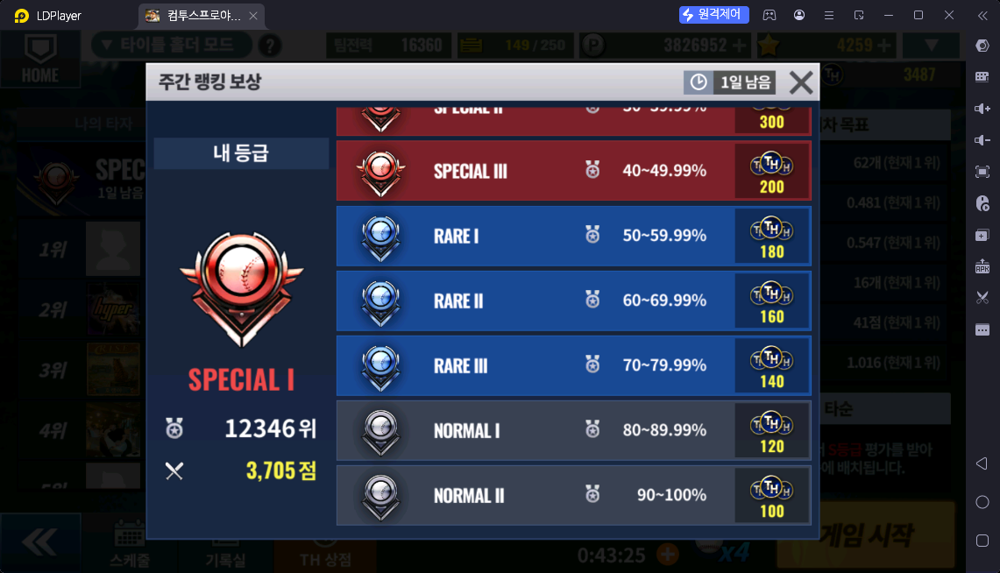

**주간 랭킹 보상 2 (PLATINUM IV ~ SPECIAL)**

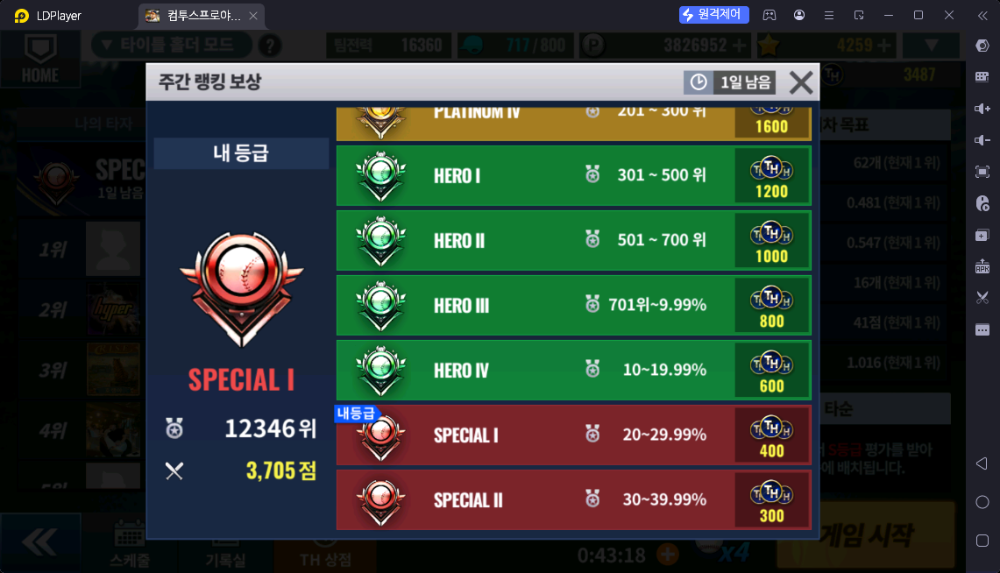

## 확인 필요

- ❓ 볼 충전 간격·최대 개수
- ❓ 어떤 타자를 등록하면 좋은가 (홈런·타점 점수가 크니 파워 위주? 🟨)
- ❓ 중도 포기(★500)는 언제 쓰나
