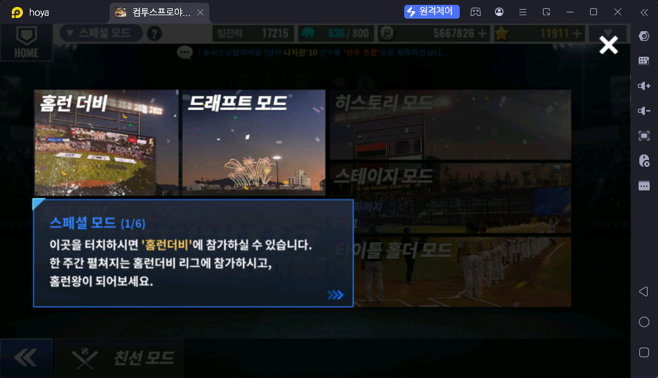
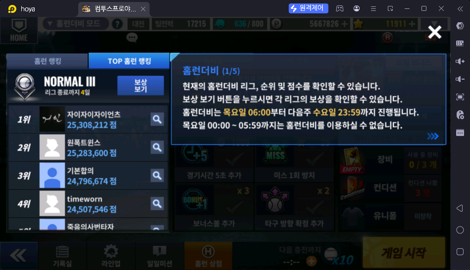
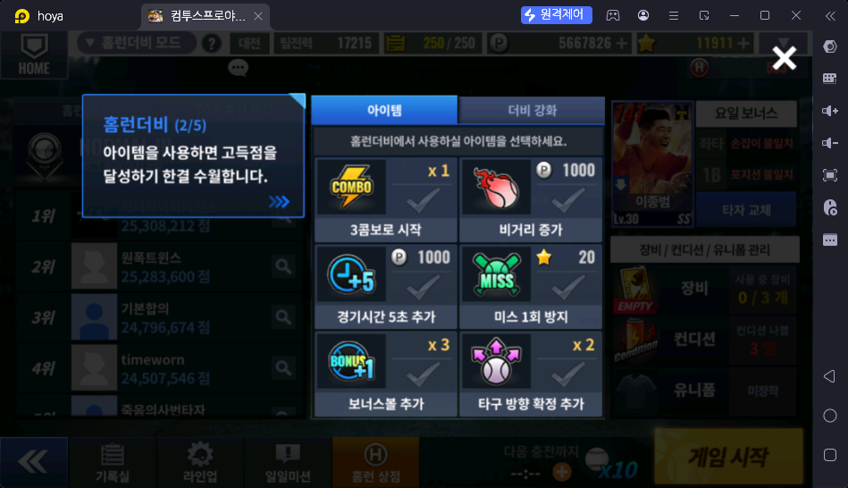
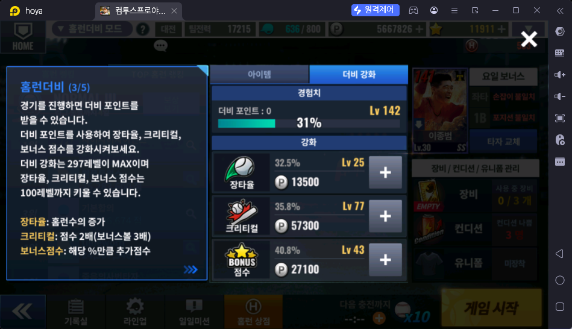
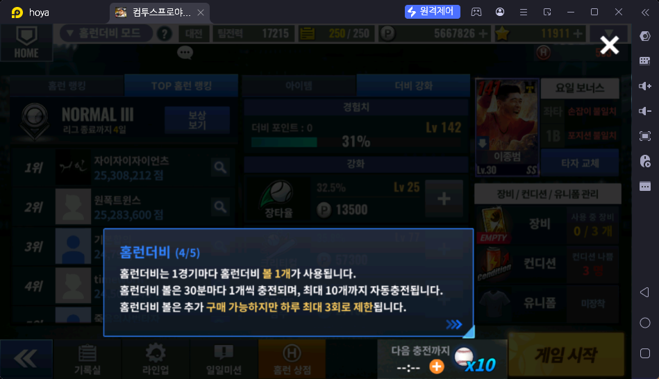
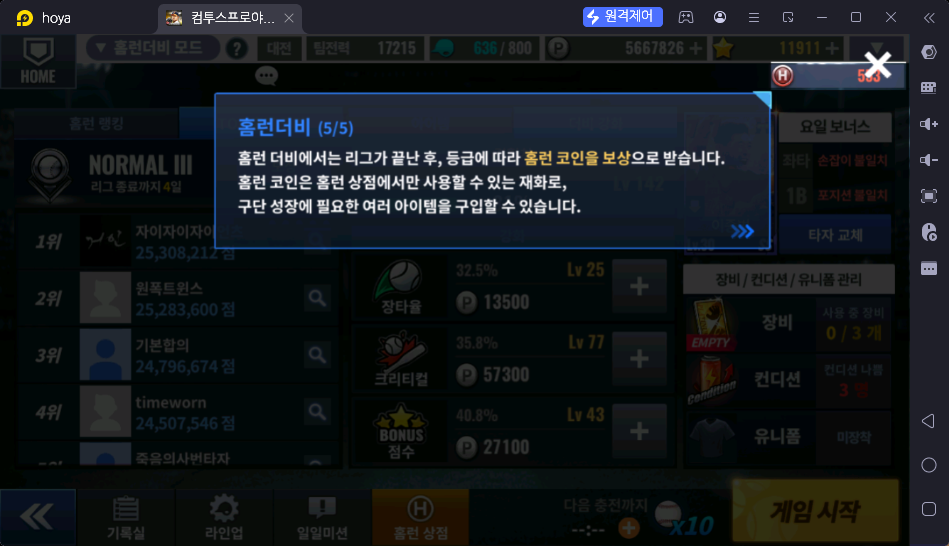
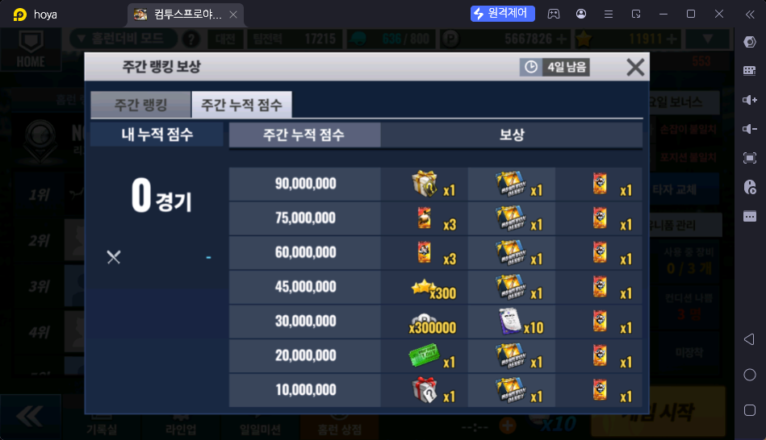
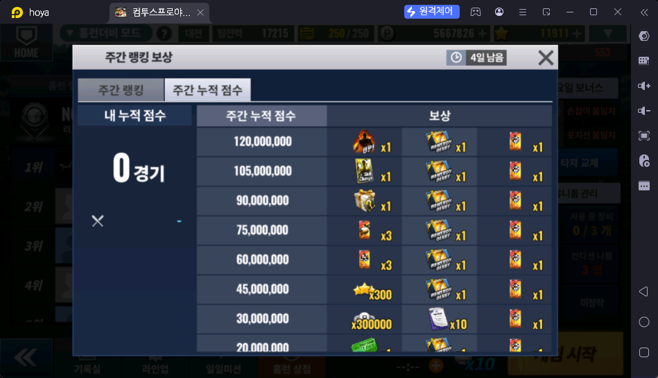
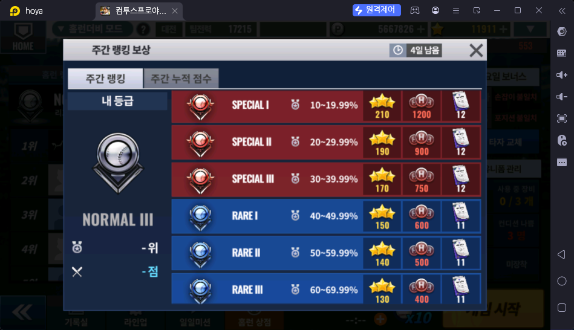
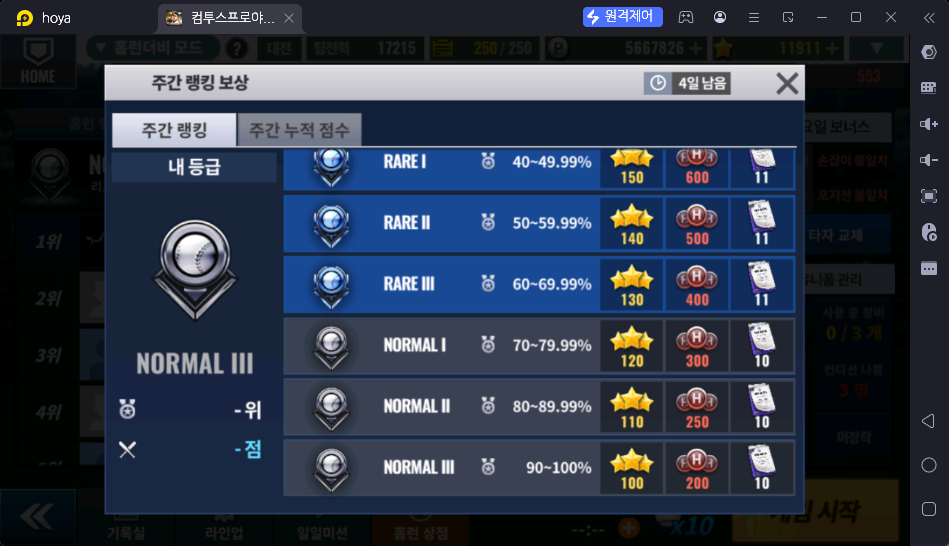

# 홈런 더비 (스페셜 → 홈런 더비)

> 출처: 게임 안 안내 1~5/5 · 주간 랭킹 보상 스샷 4장 · 홈런 상점 스샷 4장 · 운영자 설명 (2026-10-17)

## 한 줄 요약

일주일 단위 홈런더비 리그. **재화를 모으는 곳**이다. 점수로 순위를 다투고, 리그가 끝나면 스타·홈런 코인 등을 받는다. 홈런 코인은 홈런 상점에서 성장 아이템으로 바꾼다.

## 하는 방법

- **기간:** 목요일 06:00 ~ 다음 주 수요일 23:59. 목요일 00:00 ~ 05:59 는 이용할 수 없다 (정산 시간)
- 스페셜 → 홈런 더비 → 출전 타자·아이템 고르고 게임 시작
- 화면 왼쪽: **홈런 랭킹 / TOP 홈런 랭킹**, 내 리그 등급(스샷: NORMAL III, "리그 종료까지 4일"), "보상 보기"
- 화면 오른쪽: 출전 타자(스샷: 이종범 Lv30 SS) · 타자 교체 · **요일 보너스**(조건이 맞는 타자에게 보너스 🟨) · 장비(0/3) · 컨디션 · 유니폼
- 하단 메뉴: 기록실 · 라인업 · 일일미션 · 홈런 상점

### 홈런더비 볼 (입장 횟수)

- 1경기마다 볼 1개를 쓴다
- **30분마다 1개 충전, 최대 10개까지 자동 충전**
- 추가 구매 가능, **하루 최대 3회** 제한. 우정 상점에서도 판다 (200 우정포인트, 주 20회 — `../대전/친구대전.md`)

### 아이템 (경기 전 선택) — 고득점에 도움

| 아이템 | 비용 / 보유 (스샷 기준) |
|---|---|
| 3콤보로 시작 | 보유 x1 |
| 비거리 증가 | 1,000 P |
| 경기시간 5초 추가 | 1,000 P |
| 미스 1회 방지 | 20 ★ |
| 보너스볼 추가 | 보유 x3 |
| 타구 방향 확정 추가 | 보유 x2 |

### 더비 강화 (영구 성장)

- 경기를 하면 **더비 포인트**를 받아 더비 레벨이 오른다. **더비 레벨 최대 297** (스샷 Lv 142, 31%)
- P(포인트)를 써서 세 능력치를 올린다. 각각 **최대 100레벨**

| 능력치 | 효과 | 스샷 예시 (레벨 · 수치 · 다음 강화 비용) |
|---|---|---|
| 장타율 | 홈런 수 증가 | Lv 25 · 32.5% · 13,500 P |
| 크리티컬 | 점수 2배 (보너스볼은 3배) | Lv 77 · 35.8% · 57,300 P |
| 보너스 점수 | 해당 %만큼 추가 점수 | Lv 43 · 40.8% · 27,100 P |

## 보상 (보상 보기 → 주간 랭킹 / 주간 누적 점수)

두 갈래로, 둘 다 받는다 🟨

### ① 주간 랭킹 — 한 주 최고 점수(한 판 기준)로 순위

상위 몇 %인지에 따라 등급과 보상이 정해진다. 뉴비는 **SPECIAL I 이 현실적인 한계**라 그 위(상위 10% 안)는 다루지 않는다 (운영자 판단)

| 등급 | 순위 구간 | ★ 스타 | 홈런 코인 | 보라색 문서 아이템 ❓ |
|---|---|---|---|---|
| SPECIAL I | 상위 10 ~ 19.99% | 210 | 1,200 | 12 |
| SPECIAL II | 20 ~ 29.99% | 190 | 900 | 12 |
| SPECIAL III | 30 ~ 39.99% | 170 | 750 | 12 |
| RARE I | 40 ~ 49.99% | 150 | 600 | 11 |
| RARE II | 50 ~ 59.99% | 140 | 500 | 11 |
| RARE III | 60 ~ 69.99% | 130 | 400 | 11 |
| NORMAL I | 70 ~ 79.99% | 120 | 300 | 10 |
| NORMAL II | 80 ~ 89.99% | 110 | 250 | 10 |
| NORMAL III | 90 ~ 100% | 100 | 200 | 10 |

### ② 주간 누적 점수 — 한 주 점수 합계가 구간을 넘을 때마다

모든 구간에 "HOMERUN DERBY" 아이콘 아이템 x1 과 빨간 카드 아이콘 아이템 x1 이 함께 나온다 (30,000,000 구간만 보라색 문서 x10 이 대신) ❓ 아이템 이름

| 누적 점수 | 대표 보상 (아이콘으로 읽음 ❓) |
|---|---|
| 10,000,000 | 은색 선물상자 x1 |
| 20,000,000 | 초록 티켓 x1 |
| 30,000,000 | 300,000 P · 보라색 문서 x10 |
| 45,000,000 | ★ 300 |
| 60,000,000 | 카드 x3 |
| 75,000,000 | 카드 x3 |
| 90,000,000 | 금색 선물상자 x1 |
| 105,000,000 | 고유능력 변경권(Skill Change) x1 |
| 120,000,000 | "UP!" 카드 x1 |

## 보상 활용처

- 홈런 코인 → **[홈런 상점](../상점/홈런상점.md)** (홈런 로얄과 공용). 뉴비 추천: 코치 특별 계약서 · 시그니처 계약서 · 초월돌파 활성권

## 운영자 평가 · 초보 팁

## 스크린샷

**스페셜 모드 안내 1/6 — 홈런 더비**

**홈런더비 안내 1/5 — 리그·기간**

**홈런더비 안내 2/5 — 아이템**

**홈런더비 안내 3/5 — 더비 강화**

**홈런더비 안내 4/5 — 홈런더비 볼**

**홈런더비 안내 5/5 — 홈런 코인**

**주간 누적 점수 보상 1**

**주간 누적 점수 보상 2**

**주간 랭킹 보상 1 (SPECIAL ~ RARE)**

**주간 랭킹 보상 2 (RARE ~ NORMAL)**

## 확인 필요

- ❓ 누적 보상 아이콘 이름: HOMERUN DERBY 아이템 · 빨간 카드 · 보라색 문서 · 은/금 선물상자 · 초록 티켓 · UP! 카드 · 카드 x3
- ❓ 뉴비가 한 주에 현실적으로 노릴 누적 점수 구간
- ❓ 요일 보너스의 정확한 조건 (스샷 글자가 흐림: "좌타 / 1B …")
- ❓ 더비 강화 우선순위 (장타율·크리티컬·보너스 중 무엇부터)
