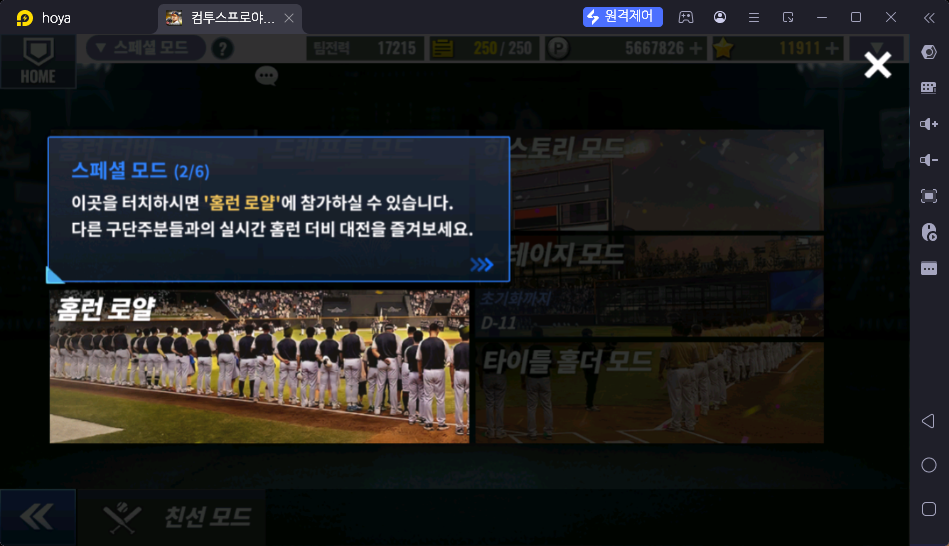
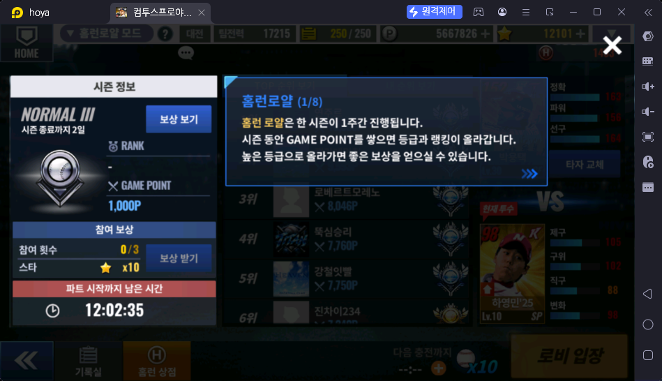
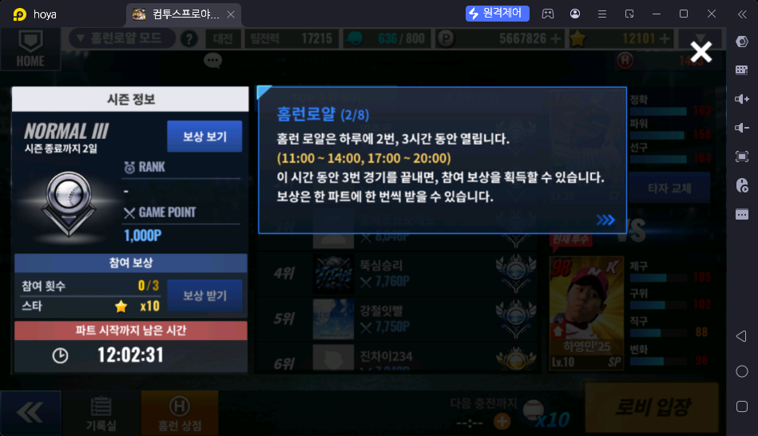
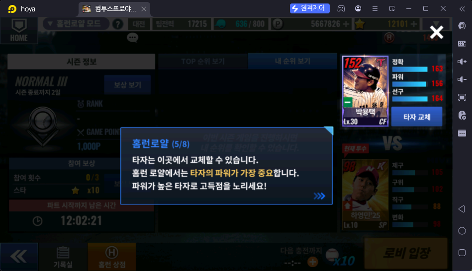
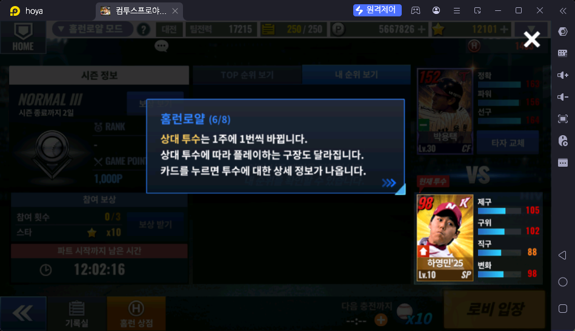
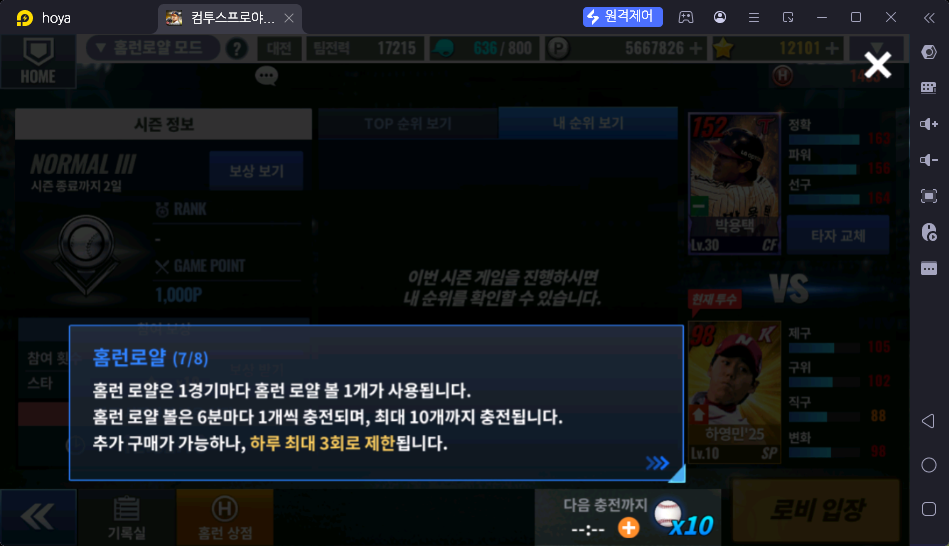
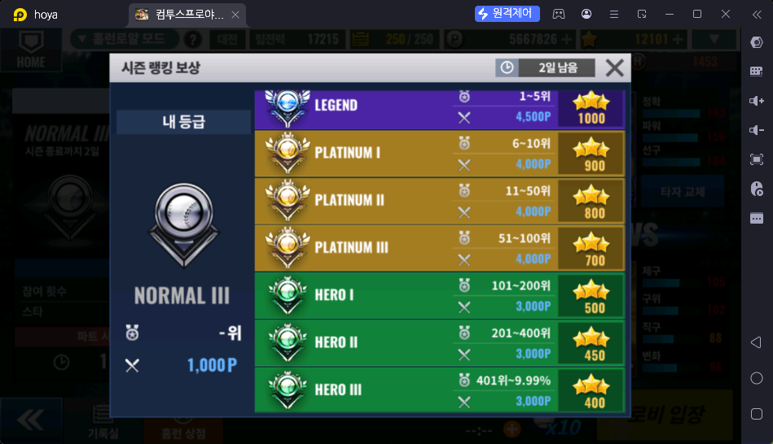
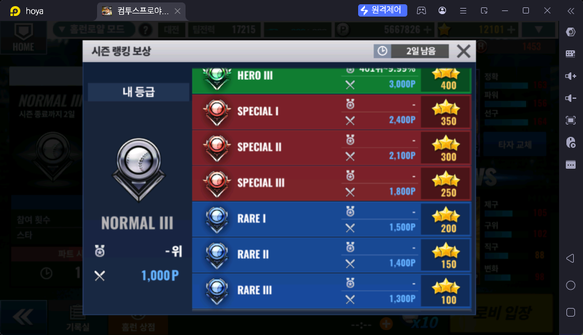
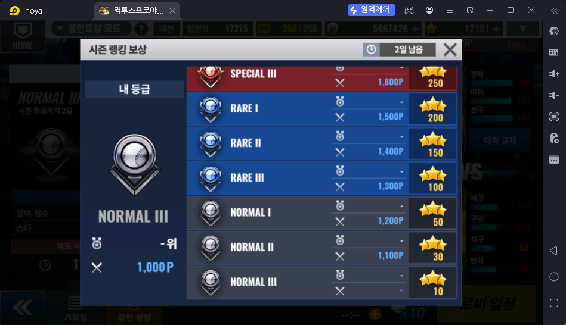

# 홈런 로얄 (스페셜 → 홈런 로얄)

> 출처: 게임 안 안내 1·2·5·6·7/8 + 8/8 문구(운영자 전달) (2026-10-17). 3·4/8 은 운영자 판단으로 생략 (필요 없는 내용)

## 한 줄 요약

다른 구단주들과 실시간으로 겨루는 홈런 더비 대전. 하루 두 번, 3시간씩 열린다. **한 경기마다 홈런 코인**을 받고, 시즌 동안 GAME POINT 를 쌓아 등급·랭킹을 올린다.

## 하는 방법

- 스페셜 → 홈런 로얄 → 타자 확인 → **로비 입장**
- **열리는 시간:** 하루 2번, 각 3시간 — **11:00 ~ 14:00**, **17:00 ~ 20:00** (화면 "파트 시작까지 남은 시간")
- **시즌:** 1주일. 시즌 동안 GAME POINT 를 쌓으면 등급과 랭킹이 올라간다 (스샷: NORMAL III, GAME POINT 1,000P, "시즌 종료까지 2일")
- 화면 가운데: TOP 순위 보기 / 내 순위 보기
- 하단 메뉴: 기록실 · 홈런 상점

### 타자와 상대 투수

- 타자는 오른쪽 "타자 교체"에서 바꾼다. **홈런 로얄에서는 타자의 파워가 가장 중요하다** — 파워 높은 타자로 고득점을 노린다 (스샷 타자: 박용택 Lv30 CF, 정확 163 · 파워 156 · 선구 164)
- **상대 투수는 1주에 1번 바뀐다.** 상대 투수에 따라 경기하는 **구장도 달라진다.** 카드를 누르면 투수 상세 정보가 나온다 (스샷: 하영민'25 Lv10 SP, 제구 105 · 구위 102 · 직구 88 · 변화 98)

### 홈런 로얄 볼 (입장 횟수)

- 1경기마다 볼 1개를 쓴다
- **6분마다 1개 충전, 최대 10개** (홈런 더비는 30분마다 — 훨씬 빠르다)
- 추가 구매 가능, **하루 최대 3회** 제한. 우정 상점에서도 판다 (200 우정포인트, 주 20회 — `../대전/친구대전.md`)

## 보상

| 보상 | 받는 조건 | 내용 |
|---|---|---|
| 경기 보상 | **한 경기마다** | 홈런 코인 (수량 ❓) |
| 참여 보상 | 한 파트(열리는 시간) 동안 **3경기를 끝내면**, 파트마다 1번 "보상 받기" | ★ 스타 x10 |
| 시즌 보상 | 1주 시즌이 끝나고 **월요일 00:01 부터 수령** | 아래 표 — 등급에 따라 ★ 스타 10 ~ 1,000 |

- 참여 보상만 계산하면 하루 2파트 × 스타 10 = **하루 최대 스타 20** 🟨

### 시즌 랭킹 보상 (보상 보기, 출처: 스샷 3장 + 운영자 설명, 2026-10-17)

- 시즌 종료 보상은 **월요일 00:01** 에 받을 수 있다
- 상위 등급(HERO III 이상)은 **순위 + GAME POINT** 둘 다 필요, SPECIAL 이하는 **GAME POINT** 만 넘기면 된다 🟨 (스샷에서 SPECIAL 이하 순위 칸이 "-")

| 등급 | 순위 조건 | GAME POINT | ★ 스타 |
|---|---|---|---|
| LEGEND | 1 ~ 5위 | 4,500P | 1,000 |
| PLATINUM I | 6 ~ 10위 | 4,000P | 900 |
| PLATINUM II | 11 ~ 50위 | 4,000P | 800 |
| PLATINUM III | 51 ~ 100위 | 4,000P | 700 |
| HERO I | 101 ~ 200위 | 3,000P | 500 |
| HERO II | 201 ~ 400위 | 3,000P | 450 |
| HERO III | 401위 ~ 상위 9.99% | 3,000P | 400 |
| SPECIAL I | — | 2,400P | 350 |
| SPECIAL II | — | 2,100P | 300 |
| SPECIAL III | — | 1,800P | 250 |
| RARE I | — | 1,500P | 200 |
| RARE II | — | 1,400P | 150 |
| RARE III | — | 1,300P | 100 |
| NORMAL I | — | 1,200P | 50 |
| NORMAL II | — | 1,100P | 30 |
| NORMAL III | — | 기본 (시작 1,000P) | 10 |

## 보상 활용처

- 홈런 코인 → **[홈런 상점](../상점/홈런상점.md)** (홈런 더비와 공용). 구단 성장에 필요한 아이템을 산다

## 운영자 평가 · 초보 팁

- 파워 높은 타자를 고른다

## 스크린샷

**스페셜 모드 안내 2/6 — 홈런 로얄**

**홈런로얄 안내 1/8 — 시즌**

**홈런로얄 안내 2/8 — 운영 시간·참여 보상**

**홈런로얄 안내 5/8 — 타자 파워**

**홈런로얄 안내 6/8 — 상대 투수**

**홈런로얄 안내 7/8 — 홈런 로얄 볼**

**시즌 랭킹 보상 1 (LEGEND ~ HERO)**

**시즌 랭킹 보상 2 (HERO ~ RARE)**

**시즌 랭킹 보상 3 (RARE ~ NORMAL)**

## 확인 필요

- ⏸ 한 경기당 홈런 코인 수량 — 나중에 디테일하게 작성 (운영자, 2026-10-17)
- ⏸ GAME POINT 증감 방식 · 뉴비가 노릴 등급 — 나중에 디테일하게 작성 (운영자, 2026-10-17)
