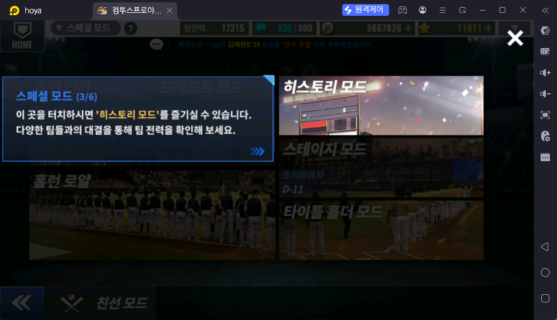
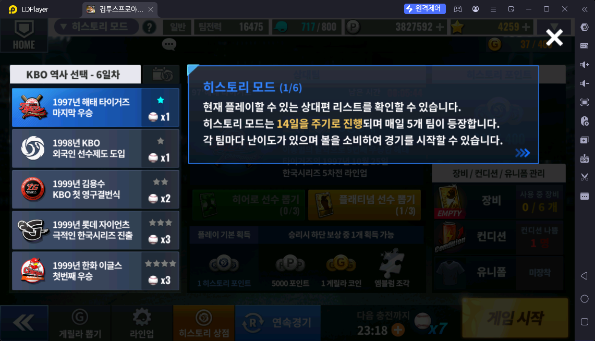
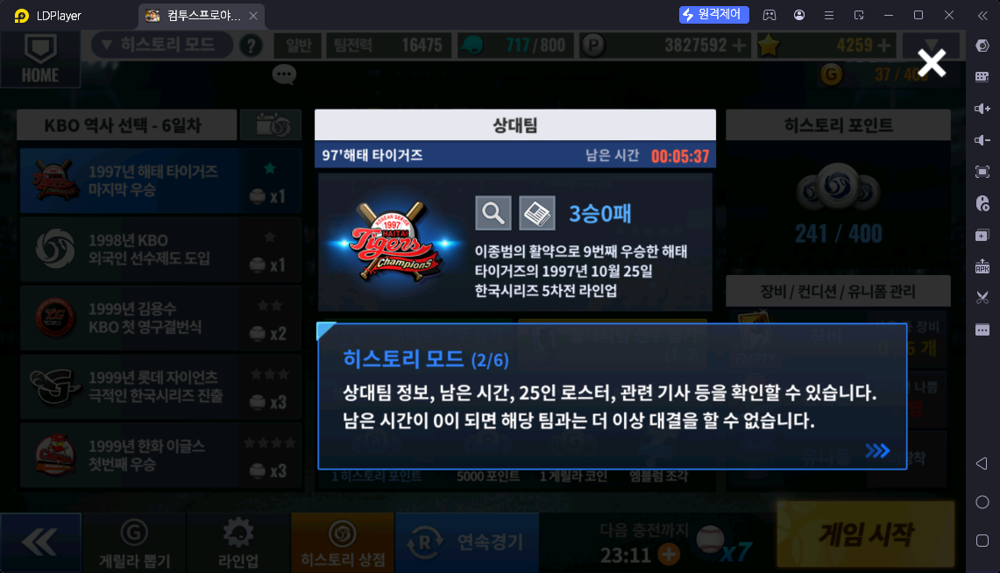
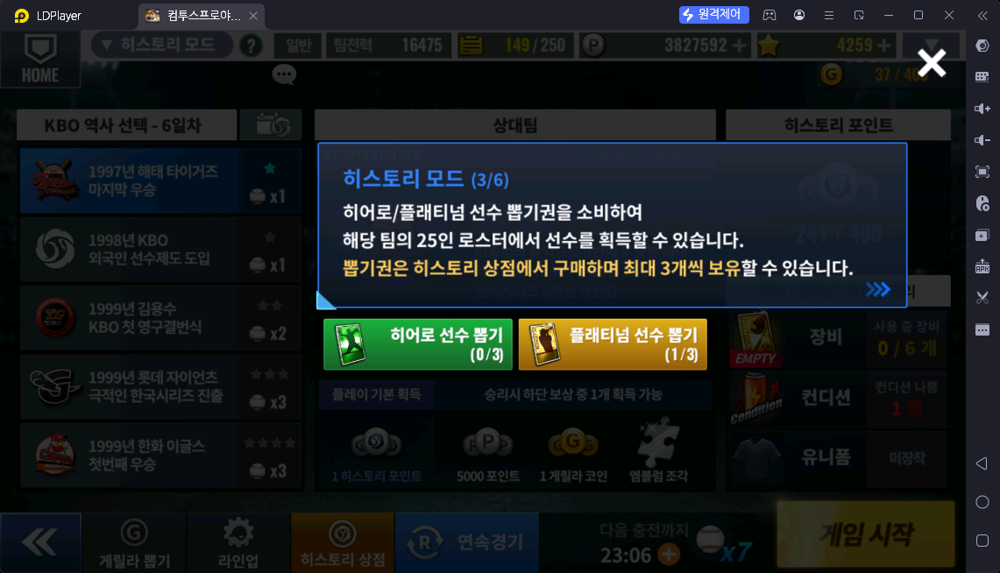
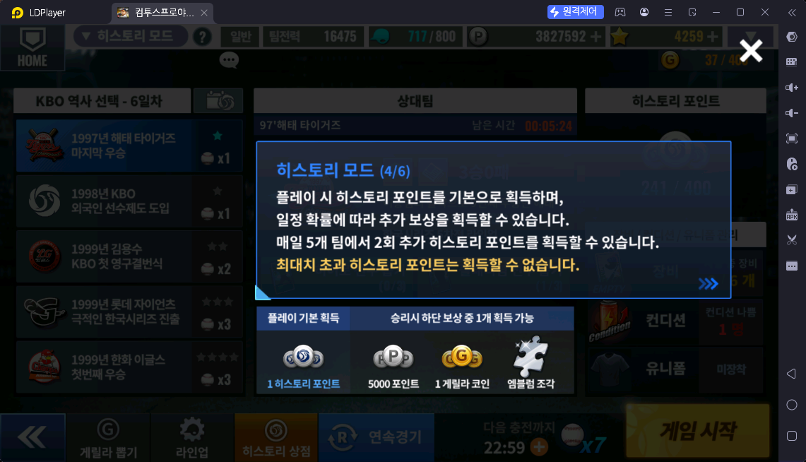
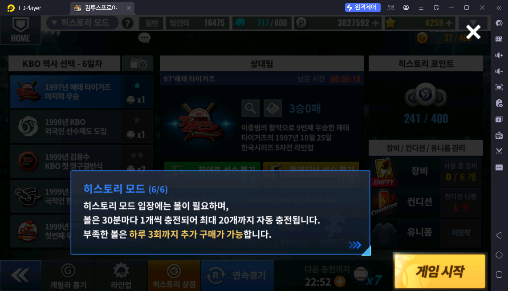
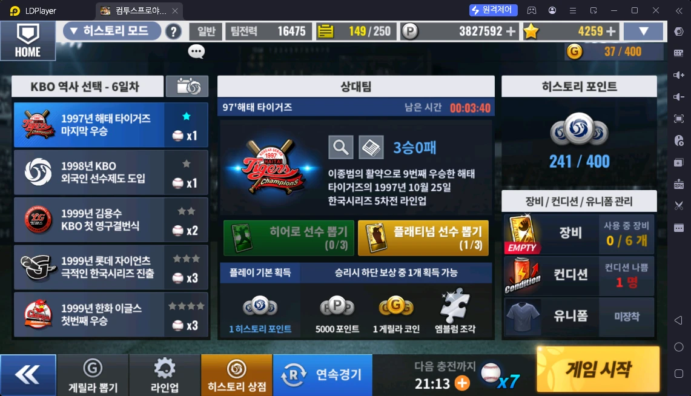
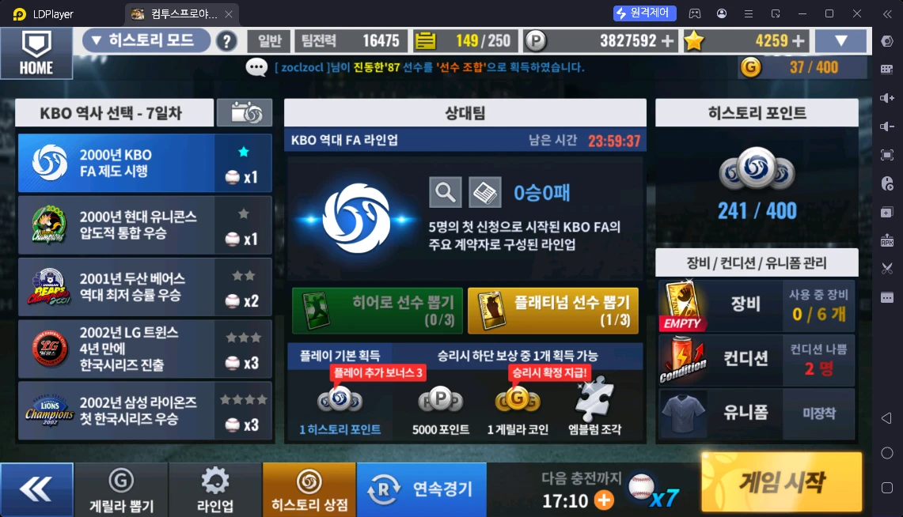
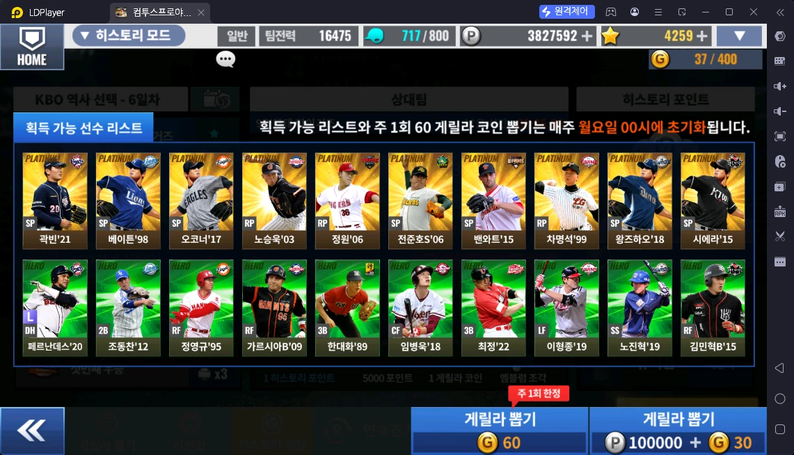

# 히스토리 모드 (스페셜 → 히스토리 모드)

> 출처: 스페셜 모드 안내 3/6 · 히스토리 모드 안내 1·2·3·4·6/6 · 메인·게릴라 뽑기·상점 스샷 · 운영자 설명 · 사이트 데이터 (2026-10-17)

## 한 줄 요약

KBO 역사 속 실제 팀(예: "1997년 해태 타이거즈 마지막 우승")을 상대하는 모드. **14일 주기로 매일 5개 팀**이 나오고, 이기면 **히스토리 포인트**와 추가 보상을 받는다. 뽑기권으로 상대 팀 25인 로스터의 선수를 얻을 수 있다.

## 하는 방법

- 스페셜 → 히스토리 모드 → 왼쪽 **KBO 역사 선택 - N일차** 에서 팀 고르기 → 게임 시작 (연속경기 가능)
- **14일 주기**, **매일 5개 팀**이 등장한다 (스샷: 6일차)
- 팀마다 **난이도(별 1 ~ 4개)**가 있고, 경기마다 **볼**을 쓴다 — 난이도가 높을수록 볼을 더 쓴다 (스샷: ★1 → 볼 x1, ★★ → x2, ★★★·★★★★ → x3)
- 매일 00시에 일차가 바뀌어 다음 일차 5개 팀이 나온다. 상대팀 칸: 팀 정보 · **남은 시간**(그날 남은 시간) · 25인 로스터(돋보기) · 관련 기사 · 내 전적(스샷 3승 0패). **남은 시간이 0이 되면 그 팀과는 더 이상 대결할 수 없다**
  - 예: "97' 해태 타이거즈 — 이종범의 활약으로 9번째 우승한 해태 타이거즈의 1997년 10월 25일 한국시리즈 5차전 라인업"
- 하단 메뉴: 게릴라 뽑기 · 라인업 · 히스토리 상점 · 연속경기

### 히스토리 볼 (입장 횟수)

- **30분마다 1개 충전, 최대 20개**까지 자동 충전
- 부족하면 **하루 3회까지 추가 구매**. 우정 상점에서도 판다 (200 우정포인트 · 주 20회 — `../대전/친구대전.md`)

## 보상

### 경기마다 받는 히스토리 포인트

하루 5개 팀은 위에서부터 난이도가 오른다. **팀 순서대로 볼 소모와 기본 포인트가 같다**

| 팀 순서 (난이도) | 볼 | 기본 히스토리 포인트 | 매일 추가 보너스 (팀마다 2판) |
|---|---|---|---|
| 1번째 (★) | 1 | 1 | +3 |
| 2번째 (★) | 1 | 1 | +3 |
| 3번째 (★★) | 2 | 2 | +2 |
| 4번째 (★★★) | 3 | 3 | +2 |
| 5번째 (★★★★) | 3 | 3 | +2 |
| **5팀 한 바퀴 (연속경기)** | **10** | **10** | **+12** |

- **매일 00시에 초기화.** 초기화 뒤 **팀마다 첫 2판**은 ① **플레이 추가 보너스**(위 표) ② **승리 시 게릴라 코인 확정 지급** (화면 "플레이 추가 보너스 3" · "승리시 확정 지급!") (팀마다 2판 — 운영자 확인)
- **하루 볼 20개(5팀 × 2바퀴)** 를 쓰면: (1+3) + (1+3) + (2+2) + (3+2) + (3+2) = 22 × 2 = **히스토리 포인트 44**
- 20볼 이후로는 보너스 없이 기본 (1 / 1 / 2 / 3 / 3) — 10볼에 10포인트
- 💡 볼 최대치도 20개라서, **매일 볼 20개를 다 쓰는 것이 기본 루틴** 🟨

### 이기면 — 아래 중 1개 무작위

| 팀 순서 | P(포인트) | 게릴라 코인 | 엠블럼 조각 |
|---|---|---|---|
| 1번째 | 5,000 | 1 | ○ |
| 2번째 | 5,000 | 1 | ○ |
| 3번째 | 4,500 | 2 | ○ |
| 4번째 | 3,500 | 3 | ○ |
| 5번째 | 2,500 | 4 | ○ |

- 어려운 팀일수록 P 는 줄고 **게릴라 코인이 늘어난다**

### 게릴라 뽑기 (게릴라 코인 사용)

- 하단 **게릴라 뽑기** → **이번 주 획득 가능 선수 리스트** (스샷: 플래티넘 10명 · 히어로 10명) 중에서 뽑는다
- 비용: **주 1회 한정 60 게릴라 코인**, 또는 **100,000 P + 30 게릴라 코인**
- 리스트와 주 1회 60코인 뽑기는 **매주 월요일 00시 초기화**
- 게릴라 코인 최대 보유 400 (스샷 37 / 400)

### 히스토리 선수 뽑기 — 원하는 팀 로스터에서 "저격"

- **히어로 / 플래티넘 선수 뽑기권**을 쓰면 **그 팀의 25인 로스터**에서 선수를 얻는다
- 뽑기권은 **히스토리 상점**에서 산다 (플래티넘 250 · 히어로 150 히스토리 포인트). 종류별 **최대 3장 보유**
- **히스토리 포인트 최대 400** — 넘게 받을 수 없다
- 💡 **최대로 모아 두면 한 번에 4장 저격:** 플래티넘 뽑기권 3장 보유 + 히스토리 포인트 400 (→ 250 으로 1장 더 구매) = **원하는 일차 · 원하는 연도 로스터에서 플래티넘 4장**
- 어느 일차에 어떤 팀·선수가 나오는지는 사이트 **[히스토리 재료 탐색기](/history-mode/legend)** 에 정리돼 있다 → 덱 빌딩·레전드 재료 계획에 쓴다 (사용법 가이드 `/guides/history-legend-guide`)

## 보상 활용처 — 히스토리 상점 (히스토리 포인트 사용)

- 상품표·추천은 **[히스토리 상점](../상점/히스토리상점.md)**
- 요약: **초보(덱 빌딩 중) → 플래티넘 선수 뽑기권** · 덱은 다 짰는데 강화가 부족 → **한계돌파권** · 레전드 재료 줍기 → 플래티넘 선수 뽑기권. 선수팩은 사지 않는다

## 운영자 평가 · 초보 팁

- 매일 00시 초기화 뒤 **볼 20개로 5팀 × 2바퀴** — 보너스 포함 히스토리 포인트 44
- 히스토리 포인트(400)와 플래티넘 뽑기권(3장)은 상한이 있으니, 넘치기 전에 **원하는 팀 로스터를 저격**해서 쓴다
- 어떤 일차에 원하는 선수가 나오는지는 사이트 히스토리 재료 탐색기로 미리 확인

## 스크린샷

**스페셜 모드 안내 3/6 — 히스토리 모드**

**히스토리 모드 안내 1/6 — 14일 주기 · 매일 5개 팀 · 난이도와 볼**

**히스토리 모드 안내 2/6 — 상대팀 정보 · 남은 시간**

**히스토리 모드 안내 3/6 — 히어로·플래티넘 선수 뽑기권**

**히스토리 모드 안내 4/6 — 히스토리 포인트 · 승리 보상**

**히스토리 모드 안내 6/6 — 볼**

**메인 화면 — KBO 역사 선택 · 상대팀 · 히스토리 포인트**

**일일 초기화 직후 — 플레이 추가 보너스 3 · 승리 시 게릴라 코인 확정**

**게릴라 뽑기 — 이번 주 획득 가능 선수 리스트**

## 확인 필요

- 없음 (엠블럼 조각은 다루지 않음 — 운영자)
